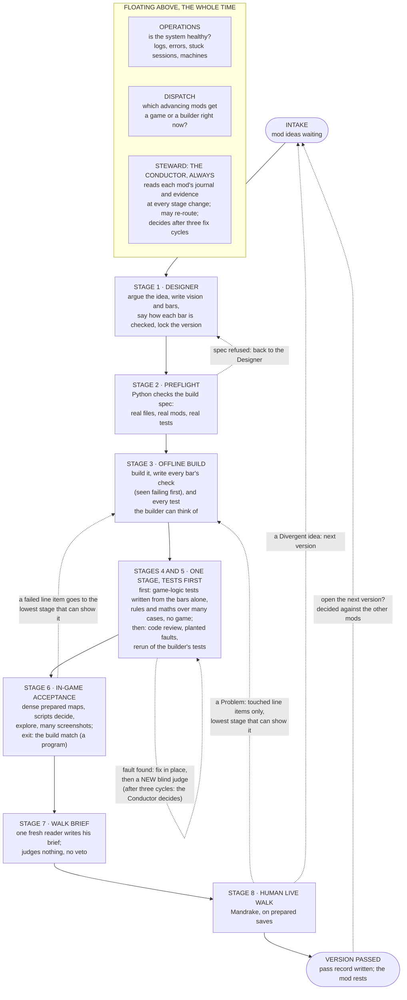

# The Maturation Pipeline as it stands today (process documentation)

Excerpted from `design/specs/2026-11-13-maturation-pipeline.md`, the live spec. Marks in the tables:
HIS = the owner's own words or card decision; CARRIED = inherited from an earlier ruling; PROPOSAL =
this document's author, not yet his.

## 2. The idea in eleven lines

1. **[HIS]** The pipeline moves **whole versioned mods**, not tickets. Tickets stay in RimFlow.
2. **[HIS]** Ideas wait at an intake. A mod then passes eight stages: Designer, preflight, offline build, offline blind challenge, offline game-logic testing, in-game acceptance, pre-human check, human live walk. **[HIS, 2026-11-17]** The pre-human check judges nothing: it is one fresh read that writes his walk brief, with no veto (§4 Stage 7). **[HIS, by card 2026-11-13]** Stages 4 and 5 run as one stage, tests first (§8, decision 1).
3. **[HIS]** A judge that finds a fault at Stages 4 and 5 fixes it at once, shows it working, and hands the mod to a **new** blind judge. The cycles are counted on the mod. **[HIS, 2026-11-13]** After three cycles the Conductor decides what to do, and he confirms or changes it when he is next available (§8, decision 3).
4. **[HIS]** Operations and Dispatch float above. Dispatch knows which mods are advancing and gives them the two games and the offline builders as they need them. **[HIS, by card 2026-11-14]** Either game may give a bar's scripted verdict, whichever is free (§8, decision 18). **[HIS, 2026-11-17]** SteveDesktop takes any mod's token-free tests whatever its stage (§8, 18c).
5. **[CARRIED]** The target holds still: a mod is built towards a locked Design Version. A change that shifts the vision goes to the next version. (His ruling of 2026-11-13.)
6. **[CARRIED]** An objection sends back only the line items it touches, to the lowest stage that can show the fault. (Rule 2 of `validation_map_and_rules.md`, his card answer of 2026-11-12.)
7. **[PROPOSAL]** The mod is the unit that flows. The line item is the unit that is re-tested.
8. **[HIS, by card 2026-11-13]** The **steward** is the Conductor, always. **[PROPOSAL]** Each mod has a **journal file**; the Conductor reads the evidence at every stage change and the journal holds the memory. This is the answer offered to "how do we preserve the intelligence".
9. **[HIS, 2026-11-13]** He may look at any stage, and questions may be sent to him at any time; the Conductor lets him know (§8, decision 5). **[PROPOSAL]** An early look produces line items like any other.
10. **[HIS, by agreement]** It is done by hand on Explosive Knockback first. **[PROPOSAL]** Only what proved boring by hand gets automated.
11. **[HIS, 2026-11-15]** The pipeline fixes its own defects once detected: a clear problem with a known fix is a ticket to file and then do in the same run, not a ticket for someone else (§5, "The pipeline fixes its own defects"). A mod's gaps still go through the stages.

---

## 3. The map

Stage numbers are his. The dotted arrows are the roads back.



Plain-text version of the same map:

```
  FLOATING ABOVE, THE WHOLE TIME
  ┌──────────────────────┬─────────────────────────────┬──────────────────────────────────┐
  │ OPERATIONS           │ DISPATCH                    │ STEWARD: THE CONDUCTOR, ALWAYS   │
  │ is the system        │ which advancing mods get a  │ reads each mod's journal and     │
  │ healthy?             │ game or a builder now?      │ evidence at every stage change   │
  └──────────────────────┴─────────────────────────────┴──────────────────────────────────┘

  INTAKE ──▶ 1 DESIGNER ──▶ 2 PREFLIGHT ──▶ 3 OFFLINE BUILD ──▶ 4+5 ONE STAGE, TESTS FIRST
  (ideas      (vision,       (Python,        (code, every bar's  (first: game-logic tests from the
   waiting)    bars, how      no model)       check, its own      bars alone, many cases, no game;
               checked, lock)                 tests)              then: review, planted faults, reruns)
                  ▲               │                 ▲              │    ▲
                  └── refused ────┘                 │              └────┘
                                                    │           fix in place, NEW blind judge;
                                                    │           after three cycles the Conductor decides
                                                    │
  ──▶ 6 IN-GAME ACCEPTANCE ──▶ 7 WALK BRIEF ──────▶ 8 HUMAN LIVE WALK ──▶ VERSION PASSED
      (dense maps, scripts,     (one fresh read;      (Mandrake, on          (pass record;
       explore, screenshots;     judges nothing,       prepared saves)        the mod rests)
       exit: the build match)    no veto)
            │                                               │
            │                                               ├── a Problem ──▶ touched line items only,
            └── failed line item ───────────────────────────┘                to the LOWEST stage (3, 4+5
                goes to the lowest stage that can show it                    or 6) that can show it
                                                            └── a Divergent idea ──▶ next version ──▶ INTAKE
```

**[HIS]** the eight stages, their order, their numbers, the fix-in-place loop, Operations and Dispatch above. **[HIS, by card 2026-11-13]** Stages 4 and 5 as one stage, tests first; the steward is the Conductor, always; three cycles, then the Conductor decides.
**[CARRIED]** the roads back from 6 and 8 (rule 2, "lowest stage, touched line items only"); the Divergent road (Design Versions ruling). **[HIS, 2026-11-17]** Stage 7 has no road back: it judges nothing, and what it notices goes into the walk brief or onto a ticket.
**[PROPOSAL]** keeping the numbers 6 to 8 unchanged after the merge (from the recommendation he answered; the card did not rule on numbering); the road from "passed" back to intake.

---

## 4. The stages, one table each

"Model tier" points at `infrastructure/agents/Agent_Policy.md` (the file that says which model does which work). The ladder is not repeated here.

"Tracked on the mod" means: written into the mod's own version record, so the status page can show it without asking anyone.

### Intake: ideas waiting

| | | mark |
|---|---|---|
| Purpose | Hold mod ideas, and mods that exist but have no locked design, until one is chosen to advance. Show how many are waiting. | HIS ("We need to show how many 'new mod ideas' we have waiting to process") |
| Who | Nobody works here. No mod enters Stage 1 until one of the four advancing mods (Explosive Knockback, FlowWorks, Gimme Some Slack, Pyrelands) reaches his live walk (Stage 8); after that they enter by his order of 2026-11-15 (§8, decision 8) with no ask (Evidence-for-Ask). | HIS, by card 2026-11-14 ("Wait for one full pass"; §8, decision 8) |
| Model tier | None. A list, read by a program. | PROPOSAL |
| Inputs | Today: 42 "first touch" Designer items in RimFlow (`python3 src/RimMandrake/Utils/owner_queue.py`, measured 2026-11-13 3:03 PM PST). Other ideas sit inside tickets and are not counted yet. | measured; "trapped in tickets" is HIS |
| Outputs | One line per waiting mod: its name, one sentence, whether code already exists. | PROPOSAL |
| Exit ("ready" means) | Closed until one of the four reaches Stage 8. The rule for leaving intake after that is asked of him then. Before that, a mod leaves intake only on his words in the request (`advance --owner-said`): "If the current mod set isn't enough to keep the pipeline busy then pick the next most mature biome mod to add." (Contagion entered this way.) | HIS, by card 2026-11-14; HIS, 2026-11-15 ~05:40 PST |
| Road back | A mod can be put back at intake at any time. Nothing is lost: its folder stays. | PROPOSAL |
| Tracked on the mod | Date it arrived; date it was picked. | PROPOSAL |

### Stage 1: Designer

| | | mark |
|---|---|---|
| Purpose | "Talk with us until we create a well defined series of specifications and acceptance criteria", to a level that will be tuned over time. | HIS |
| Who | The Designer role (`src/RimMandrake/rimflow/roles/designer.md`), with him. Its inner steps (Read, Argue the idea, Argue the edge, Write, Exam, Lock) live inside this stage. | HIS ("Within the Designer are those 1-5 steps... more like a 'Stage 1'") |
| Model tier | Judgment work: see Agent_Policy.md, "The one question". | CARRIED |
| Inputs | The idea. His words. If any code exists: a live walk of what exists, before more design is added. | CARRIED (his ruling 2026-11-12 5:06 PM PST, rule 7 of `validation_map_and_rules.md`) |
| Outputs | The mod's version folder: a short vision, the bars, and for every bar **how it will be checked (offline, or an in-game scene), with the stage that proves it**. Also the next-version file and the Polish list. | HIS by agreement (recommendation 3; the lock rule 2026-11-14); folder layout CARRIED from the Design Versions ruling |
| Exit ("ready" means) | He said "lock it" for this version, or, for a new mod's 0.1.0 with no evidence against it, the pipeline locked it (Evidence-for-Ask, 2026-11-15). Every bar is written and names how it will be checked and its stage. No check code is required. | CARRIED (Design Versions: locked on his word); the rest HIS by agreement (the lock rule, below) |
| Road back | Stage 2 refuses the spec: back here for the refused lines only. After the lock, a Divergent idea never comes back here in this version; it opens the next one. | CARRIED (rule 2; Design Versions ruling) |
| Tracked on the mod | Version number; state (drafting, locked); count of bars; tokens spent; his open questions. | CARRIED (Design Versions draft §3.7) |

#### The lock rule

**[HIS, by agreement 2026-11-14, about 12:50 PM PST]** The Conductor proposed this rule and he answered "Yes this all sounds good." (recorded on `RIMMANDRAKE_DESIGN_MATURATION_PIPELINE_WHOLE_MOD_IS_THE_UNIT`). His own words on it:

> Acceptance tests evolve just like implementation and design evolve based on discoveries as we go. So we need to acknowledge that a lock is never as strict as we'd like. But I understand the stricter the better.

> If it doesn't have good acceptance tests we need a way to get them. Designer is the only way I know how to do that... this is why most of our built mods still need that pass even if they're built.

1. **Bars and checks.** A bar is a plain sentence about what the player sees or can do; a check is the code that decides it. Bars come from the Designer pass, and every built mod still needs that pass. Checks are builder work.
2. **At the lock**, every bar is written and each names how it will be checked: offline, or an in-game scene. No check code is required at the lock. For each check Stage 2 reads its id, its stage, the file it will live in, what it will observe and the files it reads.
3. **Right after the lock (Stage 3)**, a builder writes every check, and each is seen failing where the behaviour is missing. A mod does not move past Stage 3 until every bar has a check that runs. An in-game scene may be recorded UNRUN, with its command, until Stage 6.
4. **A lock means changes are visible and have a reason, not that nothing changes.**
   - The check was wrong and the bar's meaning is unchanged: the steward (the Conductor) fixes it and re-pins it, with one journal line saying why. He is not asked.
   - A bar is added because of a discovery: agents may do it, recorded in the journal.
   - A bar is made easier or deleted outright: his call, brought to him with the discovery that made it wrong.
   - A bar is deferred (put off to a later stage or to the next Design Version): the Conductor decides and tells him after. **[HIS, 2026-11-14, about 1:05 PM PST]** "Let's try you deferring and letting me know. If it happens too often then we will change it." This is a trial he may withdraw. Each deferral is one journal line in the intervention form (§5 item 5), so the Maturation Now page counts deferrals per mod and "too often" can be seen.
   - A discovery that changes what the mod is: not a bar edit. It goes to the next Design Version.
5. **Every one of these is one journal line** in the intervention form of §5 ("The steward and the journal", item 5), so the Maturation Now page shows it as a yellow arrow on that mod's stage box. A lock reopened again and again is the visible sign that the design was not ready.
6. **The four locks of 2026-11-13** (Explosive Knockback, FlowWorks, Gimme Some Slack, Pyrelands) were valid under this rule, not early. Their missing checks are Stage 3 work.

One proposal inside Stage 1 is big enough to be an open question: whether the Designer's Exam and coverage judge stay as gates (open question 7).

### Stage 2: Preflight

| | | mark |
|---|---|---|
| Purpose | "Judge the build specification that comes out of designer, real files, real mods, real acceptance tests, Pythonic." Stop a spec that cannot be built or tested before a token is spent on building it. | HIS |
| Who | A Python program. No model. | CARRIED (his ruling 2026-11-12 3:18 PM PST: "Before a single token is spent, a deterministic python script should confirm everything it can") |
| Model tier | None. | CARRIED |
| Inputs | The locked version folder; the repo; the list of every def in the game; the mod lists. | CARRIED (spec `design/specs/2026-11-12-ticket-preflight-before-any-token.md`) |
| Outputs | A preflight record: each check, pass or refuse, the smallest fix for each refusal, and how long the run took. | CARRIED (same spec; "the precise time this took to run" is his) |
| Exit ("ready" means) | Every named file, def and mod is real. Every bar names its check. Every check names its stage. A check whose code is not written yet is not a refusal; it is Stage 3 work (the lock rule). Every test that needs the game says why an offline test cannot decide it. Every test that needs the full mod list says why. Every held look statement for this mod (`design/RimMandrake/validation_holding/`) has been placed in its table; that placement is the ingest. | First two CARRIED; "every bar has a test" HIS by agreement; "says why the game is needed" PROPOSAL (agreed by the Conductor and this writer, see below); full-list reason CARRIED (his 2026-11-12 ruling); held statements HIS, by card 2026-11-14 ("Per mod, as it advances"; §8, decision 12) |
| Road back | A refusal names the line and the fix. A wrong fact goes back to Stage 1. A broken criterion goes to the neutral fixer (a fresh agent that repairs acceptance criteria and is neither the judge nor the builder). | CARRIED (his refusal ruling 2026-11-12 2:50 PM PST) |
| Tracked on the mod | Last preflight time and duration; refusals open. | PROPOSAL |

**On "the cheapest stage that can decide it".** The Conductor proposes that preflight checks this mechanically. This writer agrees in part. Python can check that a stage is *declared* and that a game-stage test carries a *written reason*. Python cannot check that the reason is *true*. That part is judgment, and it belongs to the Stage 4 challenger, who is asked one extra question per game-stage test: "could a faster test decide this?" His settings question of today ("can't we actually simulate that settings check offline?") is exactly that question. **[PROPOSAL]**

### Stage 3: Offline build

| | | mark |
|---|---|---|
| Purpose | "Offline Build/implement including all testing it can think to perform itself." | HIS |
| Who | Builder agents, one RimFlow ticket at a time, inside this mod. | HIS (tickets stay in RimFlow); PROPOSAL (tickets are the work inside the mod's current stage) |
| Model tier | Per ticket: see Agent_Policy.md, "The ladder" and "Helpers in this repo". | CARRIED |
| Inputs | The locked version; the preflight record. | PROPOSAL |
| Outputs | Code, defs, art. For each bar, its offline test and its in-game test, each watched failing before the code made it pass. Review status clean. | CARRIED (his ruling 2026-11-13: "we build the test at the same time as the item, both offline and online versions") |
| Exit ("ready" means) | Every bar has a check that runs, each seen failing where the behaviour was missing. Every bar's offline check passes. Every in-game check exists and is listed UNRUN with its exact command until Stage 6. The builder's own list of what it could not test is written down. | HIS by agreement (the lock rule, §4 Stage 1); "passes" and the builder's list PROPOSAL |
| Road back | None of its own. Faults found later arrive here as line items. | CARRIED (rule 2) |
| Tracked on the mod | Tickets open and done in this stage; bars with a passing offline test, of total; tokens. | PROPOSAL |

For a mod that is already built (all five current mods), Stage 3 is not "build". It is "reconcile": check each locked bar against what exists, and build only the missing tests and the missing pieces. **[PROPOSAL]**

**[HIS, 2026-11-17]** From a mod's first build, the builder's brief (and the road-back fixer's) carries the offline model: decision logic Verse-free so an offline test runs the shipped decision, a generator of the mod's situations read by the bars' own checks before any fix or tuning, its range declared. One source, `roles/fable_rescue.md` step 2; `design/RimMandrake/standing_rulings.md` §Every mod builder builds the offline model from the first build.

### Stages 4 and 5: Blind offline challenge and game-logic testing, one stage, tests first

**[HIS, by card 2026-11-13]** "One stage, tests first." His question "is this really different than Stage 4, or should it be folded in?" is answered: one stage. The independence two stages would have bought is kept by order: the blind agent writes and runs its own game-logic tests from the bars alone, before it opens the builder's code or tests, and only then does the code challenge. One load of the mod, one cycle, independent tests. The two parts are reported as two lanes so the pilot can count what each finds. **[PROPOSAL]** the stage keeps the label "Stages 4 and 5", so that his numbers 6 to 8 do not move.

| | | mark |
|---|---|---|
| Purpose | Stage 4: "Offline blind code review, mutation-type coverage challenges, and verification of test outputs/rerunning plus judgement." Stage 5: "Offline game logic testing in all its many forms." In plain words: are the mod's rules and maths right over thousands of cases without the game; does the code do what it claims; can the tests actually fail; do the builder's test results repeat? | HIS |
| Who | A fresh agent that did not build the mod and is not told what any earlier judge found. | HIS ("a new blind judgement pass"; "send it back to a new blind you") |
| Model tier | A judging role: see Agent_Policy.md, "Four places a cheaper tier is forbidden outright". | CARRIED |
| Order | First, with only the locked bars, the code's logic kernels (the game-free core of a mod's rules) and the mod's settings as shipped: write the game-logic tests and run them. Then open the code, the builder's tests and their recorded outputs for the review, planted faults and reruns. | HIS, by card ("tests first"); the exact inputs per part PROPOSAL |
| Outputs | Lane 1 (game logic): test rows; random cases with the failing case shrunk to its smallest form; conservation checks (nothing created or lost); the shipped settings swept through their ranges. Lane 2 (challenge): a list of faults, each as detailed as the evidence, saying what would pass and naming the smallest fix; planted-fault results (a planted fault is a deliberate bug put in to see whether a test catches it); rerun results. | Lane 1 CARRIED (kept schemes, his picks of 2026-11-12: kernels with random cases, shipped-settings sweep with conservation laws); lane 2 HIS for the content, record shape CARRIED (refusal ruling 2026-11-12) |
| Exit ("ready" means) | Every bar tagged "offline" is green. A blind judge found nothing that is a Problem. | PROPOSAL (Problem versus Polish is CARRIED from his card of 2026-11-13) |
| Road back | "If it finds issues, it should FIX THEM RIGHT THERE and force the system to pass, but then send it back to just before Stage 4 again for a new blind judgement pass." "Once you make your list of what's wrong, you're the one who should fix it RIGHT NOW and show it working... then send it back to a new blind you." | HIS |
| What the next blind judge reads | **"All once, then changes."** The first judge reads everything. After a fix, the new judge reads the changed files and the line items whose inputs changed, without being told what the last judge found. A fault found late in unchanged material is still fixed, and is logged as a miss of the first judge. | HIS, by card 2026-11-13 |
| Tracked on the mod | "These cycles should be tracked on the work item so we can monitor a cycling ticket": the cycle count, and per cycle what each lane found, what was fixed, which tests were edited, tokens; lane 1 rows passing of total. | HIS for the count; detail PROPOSAL |

**Guards on fix-in-place.** **[PROPOSAL]** from the Conductor; this writer agrees and adds the last one.

- The fixer may not edit a bar or an acceptance criterion. A wrong criterion goes to the neutral fixer. (This part is [CARRIED], his refusal ruling.) A wrong check whose bar keeps its meaning is re-pinned by the steward, and a bar changes only as the lock rule allows (§4 Stage 1). [HIS by agreement]
- Every test the fixer edits is listed in the cycle record and shown to the next blind judge. Otherwise "force the system to pass" could be done by weakening a test.
- Added by this writer: each fix is shown red first. The fixer records the test failing on the old code, then passing on the new. "Show it working" is his phrase; red-first is how it is shown.

**After three cycles.** **[HIS, 2026-11-13, typed]** "After three cycles, Conductor is brought in (Fable 5.2 class reasoner) to make a decision on what to do. When the user is next available, they are informed and the decision is confirmed or changes made. Conductor may choose any of the options you offered, or yet more creative ones (it may see how to fix the problem in a way the judges did not)." The options offered were: defer a bar, repair a criterion, call it a design fault, or allow one more cycle. Cycles are counted on the mod; a fourth judge never starts on its own.

### Stage 6: In-game acceptance

| | | mark |
|---|---|---|
| Purpose | "In-game acceptance testing with setup maps, proper acceptance testing, and using the fastest methods available with dense, rich setups that test many items simultaneously + allowances to explore beyond the acceptance tests and plentiful screenshots to look for 'strange unexpected things.'" | HIS |
| Who | A live-test agent driving one of the two games. Scripts give the verdict on each bar; the agent explores and looks. | HIS for the stage; "scripts decide" CARRIED from the old map's stage 4 (not his by card) |
| Model tier | A live driver: see Agent_Policy.md, "Helpers in this repo". | CARRIED |
| Inputs | The mod as deployed to the game; the in-game tests from Stage 3; a prepared map built by the mod's own proof script. | CARRIED (rule 5: dense, labelled savegame on matrix scenes, his words of 2026-11-12) |
| Outputs | One verdict per in-game line item. Screenshots. A list of strange things seen that no bar covers. A labelled savegame. | HIS |
| Exit ("ready" means) | Every in-game line item passes on a site that was checked first (open sky, no stray animals). Every strange thing is either explained or filed. The savegame for him exists. | CARRIED (rule 6: "a site is asserted, never hoped", his words 2026-11-12) plus PROPOSAL |
| Road back | A failed line item goes to the lowest stage that can show the fault, and an offline test that fails on the old code is written first. Only that line item and those sharing its inputs are re-run. | CARRIED (rules 2c and 2d) |
| Tracked on the mod | Rows pass, fail and unmeasured; which game; wall time; strange things open. | PROPOSAL |

The fastest methods: the 13-mod minimal list loads in 22 seconds; the full list takes about 15 minutes. A test uses the full list only when it says why. **[CARRIED]** (his ruling 2026-11-12). A flyer's flight is never tested live without him. **[CARRIED]**

#### Which game runs what

**[HIS, by card 2026-11-14]** (§8, decision 18.) "Whichever game is free". **[HIS, 2026-11-17]** SteveDesktop's entry rule is open (18c).

| work | game | mark |
|---|---|---|
| The scripted verdict on each locked in-game bar | Either game: Dispatch takes whichever is free | HIS, by card 2026-11-14 (18a) |
| Exploring beyond the bars; screenshots looking for strange things | Archmagi | PROPOSAL: an agent must look, and the looking tools run there |
| The labelled savegame and his live walk (Stage 8) | Archmagi | CARRIED: he sits at that machine |
| Re-running a passed version's bars when something it depends on changes | Either game, through the queue (§6, "After a version passes") | HIS, by card 2026-11-14 (18b): built only after one version has passed |

**A verdict counts only on the version and list he walks.** This follows from 18a: a pass from a game that ran a different build proves nothing about the one he walks. **[HIS, 2026-11-17]** ("I approve your changes to the Step 6->Step 7 transition and preparation", item `RIMMANDRAKE_FOLD_STAGE_SEVEN_INTO_WALK_BRIEF_NO_VETO`.) The **build match** is a program, no model, run at the Stage 6 exit. Every in-game verdict row records the game it ran on, the mod's source sha, a hash of its deployed folder there, the active mod list read by parsing that game's `ModsConfig.xml` (`activeMods`, in order) and the game build: the runner gets them from `python3 src/RimMandrake/rimflow/build_match.py identity --mod <Mod> (--tier <T> | --full)` after the deploy and the list swap, and merges that line into every row. The program reads the same on Archmagi for the build he walks (the mod's deployed folder hash, the game's `Version.txt`, and the mod list of the labelled walk savegame that the Stage 6 Exit block names) and compares each check's last row with it; a row whose mod hash or game build differs does not count, and its line item is re-run. The mod list is compared as the test declares it: a full-list test (its `why_full_list` set) must match his walk's list exactly; a minimal-list test (the carried default, §4 Stage 6) must match the list `modset_builder.py` builds for its tier from the same commit, and his walk is the check of that verdict on his full list. `maturation.py` runs it in its Stage 6 exit reading (its `build_match` clause); `python3 src/RimMandrake/rimflow/build_match.py check --mod <Mod> [--visit N]` runs it alone and exits 0 only when every check counts. Selftest: `src/RimMandrake/rimflow/selftest_build_match.py` (with `--mutants`).

**Entry rule. [HIS, 2026-11-17, about 11:00 AM PST]** "Drop 11-14 limits, old rule. Clear its limitations. We are remeasuring it for a brand new pipeline." (item `RIMMANDRAKE_DROP_STEVEDESKTOP_PIPELINE_ONLY_LIMIT`.) Any mod's token-free test, proof chain, `--full` sweep or `--item` selection may be queued and filled on SteveDesktop whatever its pipeline stage. `src/RimMandrake/Utils/testq/pipeline_admit.py`, called by `testq.py submit` before anything else and by the filler, the nightly sweep and the fault-window rerun, refuses one thing: a mod on his hold (`src/RimMandrake/rimflow/mod_owner_hold.json`, his 2026-11-16 hold), and every test while that list cannot be read. The filler (`coverage.fill_mods`) leaves held mods out. Ops jobs are never refused: the brake-release canary (`Operations.canary`) and the steward's repair wake (`BENCH.steward-wake`). The machine-safety brakes (fault monitor, hardware outage, brake release) are unchanged. Stage-6 `testq` blocks (`testq_blocks.py`) still name the modcheck chain of each check, so the filler walks a past-blind mod without hand wiring. Selftest: `src/RimMandrake/Utils/testq/selftest_testq_pipeline_admit.py` (with `--mutants`).

### Stage 7: Pre-human check, the walk brief

**[HIS, 2026-11-17]** Stage 7 judges nothing. He asked "What is step 7 in the maturation pipeline other than redundancy with just-passed judges?" and approved the change: the judges have judged, the build match (Stage 6) has kept only the verdicts made on the build he walks, and what is left is one fresh read that prepares his walk.

| | | mark |
|---|---|---|
| Purpose | Prepare his walk: one fresh read of the evidence "as not merely sufficient but consistent and not containing obvious anomalies beyond the stated goals that would waste a human's review time". What it finds goes into his brief or onto a ticket; it refuses nothing. | HIS (the quote); HIS, 2026-11-17 (no veto) |
| Who | ONE fresh reader that made none of the evidence writes: no stage move of this version and no in-game row. `maturation.py` refuses a brief whose `written_by` names a unit that made either. | HIS, 2026-11-17; CARRIED (user-level rule, 2026-10-22: "Read it first and see if it's obviously broken... before wasting a human's time") |
| Model tier | A reading role, one run. | PROPOSAL |
| Inputs | Everything from stages 2 to 6: records, test rows, screenshots, the savegame, the build match's reading, the journal and the commits since his last look, the mod's open tickets. | PROPOSAL |
| Outputs | The walk brief, `design/concepts/<Mod>/version/walk_brief/arrival_<N>.md` (N = arrivals at this stage), under four headings: what to open; what changed since his last look; "known, not fixed: you need not report these"; what it noticed first. Role: `src/RimMandrake/rimflow/roles/walk_brief.md`. | HIS, 2026-11-17; CARRIED (rule 4) |
| Exit ("ready" means) | The brief is written, its four headings filled, by a fresh reader. It has NO veto: a finding goes into the brief or onto a ticket, never down a road. No `--steward-confirms`. | HIS, 2026-11-17 |
| Road back | None. | HIS, 2026-11-17 |
| Tracked on the mod | Arrivals at this stage (`pre_human_arrivals`). Each arrival is one release candidate: 0.1.0-rc.1, 0.1.0-rc.2. Version numbering is unchanged. | CARRIED ("A judge round is a release candidate") with a PROPOSAL about what counts as a round (open question); HIS, 2026-11-17: the rc count per arrival stays |

### Stage 8: Human live walk

| | | mark |
|---|---|---|
| Purpose | "Human live-walk of prepared sittings, savegames, maps, etc." | HIS |
| Who | Mandrake. | HIS |
| Model tier | None. An agent may sit with him to stage and record. | PROPOSAL |
| Inputs | The Stage 7 brief; a dense, labelled savegame. | CARRIED (rule 5) |
| Outputs | His words, verbatim, in the ledger. Each thing he says becomes one line item with a class: mod fault, test-map fault, test-tool fault, art, new bar, or question. Each pass he gives is pinned. | CARRIED (rules 2a and 2e) |
| Exit ("ready" means) | He passes the version. The pass record is written: date, git commit, bars, evidence, cost, cycles. | CARRIED (Design Versions draft §3.7); the pass is his alone |
| Road back | A Problem (a defect, or something a player would reject as strange or disappointing) stays in this version and goes to the lowest stage that can show it. Polish goes to the mod's Polish list, confirmed with him. A Divergent idea goes to the next version. His objection closes only on his own later look, as a labelled cell in the next save he opens anyway. | CARRIED (his cards of 2026-11-13 and 2026-11-12) |
| Tracked on the mod | His minutes; objections by class; pinned passes; the pass record. | PROPOSAL |

---

## 5. Floating above

### Operations

**[HIS]** "Operations monitoring the functioning of the system, the flow of items, logfiles, lack of errors, resources, no idle/stuck sessions or machines, etc. as before."

Nothing changes in what Operations watches. **[PROPOSAL]** One thing is added to its list: a mod whose stage has not moved for longer than that stage's usual time is "stuck", and is reported the same way a stuck session is. **[HIS, 2026-11-14 ~9 PM PST]** (the same words as under Dispatch) Built for the offline build: ops_watch's `maturation.idle_owed_max_min` reading and its one fixed alarm `OPS_MATURATION_IDLE_ADVANCING_MOD`, for an advancing mod at an offline stage with work owed and nothing running on it for over 60 minutes.

### Dispatch

**[HIS]** "Dispatch ensuring timely execution of processing and agents, closing of finished agents, as before. Except that dispatch isn't working 'by the ticket' anymore. It instead knows which Mods we are currently advancing and is opportunistically allowing them access to the two live games or offline builders/fixers as they currently need as they move through the system."

**[PROPOSAL]** What replaces "take the next ticket":

- Dispatch holds a short list of **advancing mods**. Everything else waits at intake or rests. **[HIS, by card 2026-11-14]** The list is the four (Explosive Knockback, FlowWorks, Gimme Some Slack, Pyrelands), and Dispatch adds no mod to it until one of them reaches Stage 8 (§8, decision 8). **[HIS, 2026-11-14 ~9 PM PST]** Graffiti joined the list by his word that night (it stands at the Designer, which Dispatch never launches).
- For each advancing mod it asks one question: what does this mod's current stage need right now? A game, an offline builder, a blind judge, or him.
- The two games are the narrow point. A mod at Stage 6 waits for a game; a mod at Stage 8 waits for him and for the game on his machine. Offline stages never wait for a game.
- **[HIS, by card 2026-11-14]** (§8, decision 18) Dispatch sends a Stage 6 mod's scripted bar verdicts to whichever game is free. Stage 8 is Archmagi only [CARRIED: he sits there]. SteveDesktop's queue admits only tests that came through the offline stages (§4 Stage 6, "Which game runs what"), so Dispatch, not the queue's filler, decides what SteveDesktop runs.
- Inside a stage, the work is still tickets in RimFlow. The stage's worker picks among that mod's tickets. Nobody picks among all tickets of all mods.
- **[HIS, 2026-11-14 ~9 PM PST]** "So can we wire up Operations/Dispatch such that they do advance on these offline builders? This was pretty inefficient and pointlessly it seems, if I'm reading correctly. As long as we don't have automated loops rejecting/cycling things, we can't get into too much trouble." (That evening all four advancing mods had sat at Stage 3 for 6 to 9 hours with no builder on them: every launch was a Conductor hand step.) So Dispatch launches offline builders by itself: `src/RimMandrake/rimflow/maturation_dispatch.py` on `rm-maturation-dispatch.timer`, every 60 seconds (page and launch decisions alike; a run that ended under 180 s ago is not judged yet), no model of its own. For each advancing mod at Stage 3 whose exit tests refuse bars as build work and that has no detached run live on it, it launches one capped builder (opus, USD 15, `maturation.py launch`). Guard rails, his condition: one live builder per mod and at most two on advancing mods at once; after a run ends the next starts only if the count of refused bars fell, otherwise (or past USD 60 spent at the stage) it stops on that mod with a "Needs Conductor" line and never tries the same refusals again; it never judges, rejects, sends a mod back or advances it, and launches nothing at any other stage but the blind challenge and in-game acceptance (the Designer stays his; the pre-human check onward stay hand steps). At the blind challenge it launches one capped judge per visit when the cycle is owed and nothing is live or recorded on it, never a second automatically; every ended cycle is a "Needs Conductor" line and the steward still confirms the exit (item RIMMANDRAKE_BUILD_BLIND_CHALLENGE_LAUNCHER_FOUR_MODS_PARKED, 2026-11-15). At in-game acceptance it launches one capped live driver per visit when the visit is owed, nothing is live on the mod, no in-game run is live on any mod (one live-game driver at a time) and `rimflow bridge idle` says the bridge is takeable; it ships off (`ingame_enabled` false in `maturation_dispatch.json`) until the Conductor has run the first visit by hand, and every ended visit is a "Needs Conductor" line (item RIMMANDRAKE_BUILD_IN_GAME_STAGE_LAUNCHER_PYRELANDS_ARRIVED_FIRST, 2026-11-15). A mod whose exit tests all pass gets "ready to advance" for the Conductor. Graffiti joined the advancing list by his word the same night.
- Work that belongs to no mod (tools, infrastructure) stays ticket work as today. A tool ticket that blocks an advancing mod takes that mod's urgency. (Open question "Tickets that belong to no mod".)

### The pipeline fixes its own defects

**[HIS, 2026-11-15]** "the Pipeline fixes its own issues once detected. When there's a clear problem and a known fix... do it. It's not a ticket for someone else, it's a ticket to file then do yourself." (Both messages in §1.)

What that means, for every agent and program in the pipeline (the tick, the steward, a judge, a fixer, a builder, a Conductor helper):

- It finds a defect in the **pipeline itself** (its code, tools, records, tests, status page) with a clear cause and a known fix. It files the ticket with its acceptance test, does the fix in the same run (tests first), publishes, and says so in its report.
- A program does a deterministic fix itself and logs it. When the fix needs a model, the program files the ticket and launches a fixer on it itself, inside its live and spend caps. Nothing waits for a hand.
- It hands off only when the fix is not known, is outside its tools (it needs the game and holds no bridge, or needs him under `delegation_policy.md` §2), or would change a north-star bar. The ticket then carries the evidence and what was tried.
- A workaround by hand without the permanent fix is not allowed.
- Scope: the pipeline's own machinery. A mod's gaps keep going through the stages as designed.

Full text: `design/RimMandrake/standing_rulings.md` §"The pipeline fixes its own defects". Which "Needs Conductor" lines the tick still raises, and which of them it now fixes itself: the prose of item `RIMMANDRAKE_HARDEN_PIPELINE_WHERE_HANDS_CLEANED_UP`.

**Every hand act is recorded, and one nobody followed up alarms.** The owner, 2026-11-15: "ensure that the wisdom of what it had to fix has been built into the Pipeline itself so that it will do the right thing from now on, NOT merely rely on Conductor/Owner to notice and request an inspection." The census of every Conductor intervention up to that day, each with the lesson and where it is built, is `design/RimMandrake/pipeline_interventions_census_2026-11-15.md`. From then on the tick records each hand act itself (`src/RimMandrake/rimflow/maturation_hands.py`: a ceiling release, a `clear`, a coverage release, a stage run or stage move made by hand, a tick-launched item closed from a window, a settings edit, a gap in the tick). An act is followed up by a ledger item that builds the hand's judgement into the pipeline, or by a census row it repeats (`maturation_hands.py fold`); one left a day with neither raises `OPS_MATURATION_HAND_ACT_UNFOLDED`.

### The steward and the journal

**[HIS]** "How can we preserve that extremely productive interaction I enjoy when I work with you tightly like I'm doing right now? When we spot things together? Should Conductor (or something like Conductor) be floating over the process more regularly, taking in the status of items, peeking in on live game runs or findings, remembering the 'beyond this one moment' context to recognize problems, etc?"

**[PROPOSAL] Where the intelligence is lost** (the Conductor's reading; this writer agrees):

- A gate replaced a judgment. A gate can only say yes or no to the question it was built with.
- Each agent saw one slice at one moment. Nobody held the whole mod in mind across days.
- Machinery was built before the work had been done once by hand.

Today's measured example: the Designer loop on Explosive Knockback charged about 97 million tokens to its stage record without its judge ever passing, and its last six gaps were one-line paper edits. (Of that total, 86.5 million are estimates entered as "unmeasured" charges and 10.7 million are measured; source `design/concepts/ExplosiveKnockback/version/VERSION.json`.) By the Designer's own inner steps: 54 million in Write, 34 million in Exam, 8.5 million in Lock, which includes the judge. No single agent in that loop was in a position to say "this is silly".

**[HIS, by card 2026-11-13] The steward is the Conductor, always.** Not a standing seat per mod, and not a duty handed to any fresh agent. **[PROPOSAL]** for the rest of this list (the Conductor's proposal):

- The steward reads the evidence at **every stage change**. It may look in on live runs. It is allowed to say "this is silly" and re-route the mod. It brings him short, ranked sittings.
- Judgment lives at the stage changes. The plumbing between them is automated.
- Each mod has a **journal**: one file with the vision, his words, the history, the oddities, and what was tried. The memory lives in the journal, not in any agent's context window, so it survives a restart.

**The cost, named.** A steward is a reader that floats. Every stage change costs one read of the journal and of the new evidence. Bounds proposed by the Conductor: the steward reads summaries and records, not raw logs; it acts at stage changes and at alarms, not on a timer.

**Where this writer disagrees with the Conductor, or adds:**

1. **The journal is what keeps the Conductor from becoming the memory.** The steward is now always the Conductor (his card). The journal must still be complete enough that a restarted Conductor can do one stage change from the journal alone; that is the test of the journal.
2. **The journal needs a shape or it becomes one more stale file.** Proposal: a top part of at most two screens, "the mod as it stands", rewritten at each stage change; below it, a dated history that is only added to. At each Stage 8 the top part is read to him. He is the only one who can say the picture of his mod is wrong.
3. **A steward does not replace him spotting things.** What he describes as productive is a short loop: he looks, says something, and it changes while he is still there. Eight stages make that loop longer. **[HIS, 2026-11-13, typed]** "Yes, at any stage, and questions can be sent to the user at any time. If I can get to them, I might be able to steer out of a coming confusion early. Conductor will let me know." So the Conductor offers him a look at any stage and sends him questions as they arise, without waiting for Stage 8. Stage 8 is the formal walk, not the first time he sees the mod. (This extends his Designer ruling of 2026-11-12: "If we can insert an owner quick-look to settle a difficult or several questions swiftly, offer that loudly".)
4. **Live looks must feed the design.** Today the Designer loop ran on paper beside the hands-on work, and what he saw in the game never reached its scenes (measured by the Conductor today). Proposal: every look, early or formal, writes its line items into the same version folder the Designer locked. There is one list of bars per version, not a paper one and a hands-on one.
5. **[RULE, Conductor, 2026-11-14] Every steward intervention is one journal line, in one fixed form.** A steward's decision, a re-pin of a lock record, a hold, its release, a relaunch, or a brief carrying "Steward's decisions" is written, when it is made, under the journal's `### Conductor interventions` heading (the first part of the history) as:
   `- CONDUCTOR INTERVENED (stage 3, 2026-11-14 12:15 PST, kind hold): <one plain line: what it did and why>. Source: <run, commit or ledger id>.`
   The stage is `intake`, `1` to `8` (4 and 5 are one stage); the time is Pacific; the kind is one of decision, re-pin, hold, release, relaunch, brief, bar-added (a bar added under the lock rule, §4 Stage 1, item 4). A hold stands until a `kind release` line for the same stage. A ledger note on the mod's pipeline item may carry the same line. `src/RimMandrake/Utils/maturation_now.py` reads both every run and marks the stage with a yellow arrow; a line it cannot parse is listed under "Needs Conductor", never dropped.

---

## 6. Flow and re-testing: two different units

**[PROPOSAL]** from the Conductor; this writer agrees.

- **The unit of flow is the versioned mod.** The status page shows mods, not tickets.
- **The unit of re-testing is the line item.** When something sends work back, only the touched line items and those sharing their inputs are re-run. Every other stored pass stands. [CARRIED: rule 2d, his card of 2026-11-12: "Piecemeal revalidation of specific touched line items is crucial".]
- **Tickets stay in RimFlow.** A ticket is a piece of work inside a mod's current stage. [HIS: "This isn't a ticket tracking system I'm describing, that's RimFlow".]
- **A Problem fix stays in the version.** A Polish idea goes to the Polish list. A Divergent change goes to the next version and enters at Stage 1. [CARRIED: his rulings and cards of 2026-11-13.]
- **A PATCH** (a small correction after a pass, the third number of the version) re-tests only its touched line items and takes the light path. [CARRIED for the meaning of PATCH; the light path is the open question "The light path".]
- **After a version passes**, its in-game bars are re-run when something they depend on changes (a file a line item reads, a mod it loads with, the game itself), not on a blind schedule. **[HIS, by card 2026-11-14]** (§8, decision 18b, "On change, built later"): the design stands and nothing of it is built until one version has passed; until then a passed version is re-tested by the queue's existing schedule (its filler and nightly sweep, which admit a passed version's bar checks under the entry rule). **[PROPOSAL]** A re-run that fails becomes a line item on that mod like any other.

**What is tracked on each mod**, in one record beside its version file. **[PROPOSAL]**

| field | example |
|---|---|
| Design Version and state | 0.1.0, locked |
| Stage now, and since when | Stage 4, since 2026-11-14 10:20 PST |
| What it is waiting on | a game / a builder / a blind judge / Mandrake / nothing |
| Bars: total, with a test, passing at each stage | 59 / 59 / 51 offline, 0 in game |
| Cycles at Stages 4 and 5 | 2 |
| Release candidate number | rc.1 |
| Cost per stage | tokens, wall time, his minutes |
| Held items: Polish list size, next-version file size | 0, 1 |

---

