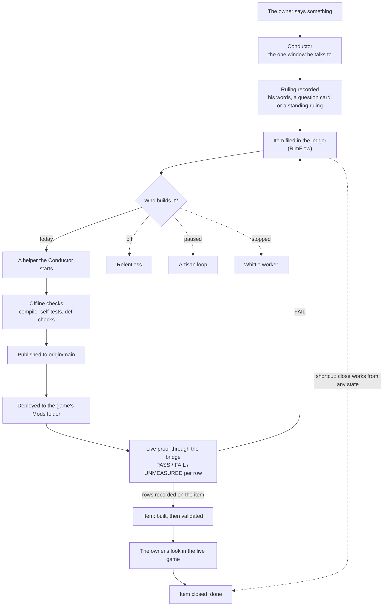
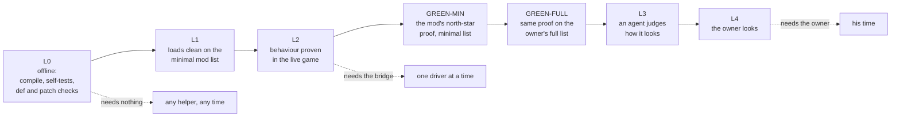
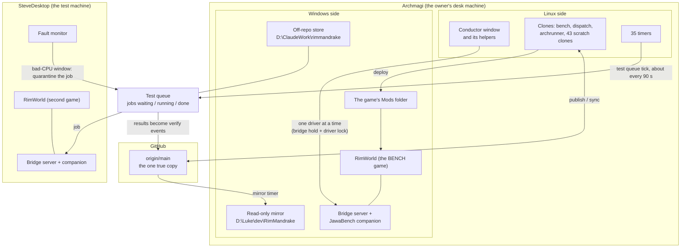

# The RimMandrake production system: a map, 2026-11-12

Asked by the owner, 2026-11-12: "...scan the entire RimMandrake production system... a beautiful markdown that
helps me simply see the relative sizes, functions, and some kind of wire diagram on how they all link together."

This is a picture of the machine that builds the mods, not of the mods. Every number is tagged `[measured]`
(counted today on origin/main at commit `16903276c6`, or on the live disk; the method is in the appendix) or
`[guess ~N%]` (my confidence it is right). Times are Pacific. Nothing was changed, and no game, bridge or test
queue was touched to write it. The companion files are the project word list `LEXICON.md` at the repo root and
its reasoning, `design/RimMandrake/lexicon_audit_2026-11-12.md`.

## 1. The one-minute version

1. **The tooling is bigger than the mods.** The programs that file, build, test and guard the work are 782,000
   lines of code. All the C# in all 134 mods is 587,000 `[measured]`.
2. **Almost half of that tooling is tests of the tooling.** 1,586 Python self-test files, 341,500 lines
   `[measured]`.
3. **Nearly every automatic builder is switched off today.** Relentless, Artisan, Whittle, the Designer and the
   Dispatcher are all stopped or paused. The work is being done by the Conductor window and the helpers it
   starts by hand `[measured: units, pause files, conductor log]`.
4. **The work record says "done" far more often than the game does.** The ledger holds 7,579 work items, 5,161
   of them done `[measured]`. No whole mod has yet been accepted by the owner through any of the builder loops
   `[measured in the 2026-11-12 agent systems assessment]`.
5. **The slow part is the live game.** A full mod list takes 15 to 25 minutes to load; a 13-mod list takes 22
   seconds. One test job carries about 140 seconds of fixed cost, and 25 of the last 85 jobs gave no usable
   answer `[measured in the 2026-11-12 live-test speed assessment]`.

## 2. The parts and their sizes

One block is 20,000 lines of code (Python and C#). XML and prose are listed in the table but not drawn.

```
WHAT SHIPS
  Mod C#, all three tiers        █████████████████████████████▍  587k
    of which FlowWorks C#        ████████                        162k
  Proof and tool Python
    kept inside mod folders      ████████████████▏               323k
    of which FlowWorks northstar ███▊                             77k

WHAT BUILDS AND CHECKS IT
  Utils (general tooling)        █████████████████████████▎      505k
    of which self-tests          ████████▏                       165k
  RimFlow (work ledger + roles)  ████████▎                       165k
    of which self-tests          ████▋                            93k
    of which Relentless          █▌                               31k
  Bridge companion (JawaBench)   ████▊                            95k
  Test queue (inside Utils)      ▋                                15k
  Hooks (refuse bad actions)     ▌                                10k

WHAT IS LEFT OVER
  whittle/ (copies of mod source
  kept as evidence)              ████████████████████████████████████████…  2,051k (runs off the page)
```

| Part | Size `[measured]` | What it is for, in one line | State today |
|---|---|---|---|
| The mods (`src/`) | 134 mods: 80 RimMandrake, 20 RimStarWars, 34 RimUtinni. 587k lines C#, 737k lines XML | What a player gets | Being built |
| FlowWorks | 162k C#, 77k proof Python | The flagship: a liquid engine (canals, pits, ponds, tanks, hoses) | Being built; 14 of 30 bars passed in its last loop |
| Proof scripts in mod folders | 323k Python; 142 `validation*.py` files, 94k lines | Drive the live game and say PASS or FAIL per row | Running |
| Utils | 1,846 files, 505k lines | Everything general: deploy, build, art pipeline, test queue, status pages, health checks | Running |
| RimFlow | 395 files, 165k lines; 46 commands | The record of work: every item, who has it, what it still owes | Running |
| The ledger | 46,847 events in 19 files, plus 10,890 frozen older ones; 7,579 items | The data RimFlow keeps | Running |
| Bridge companion | 144 C# files, 76k lines; 432 tools | Lets a script drive the running game from outside | Running |
| Test queue ("testq") | 15k lines; 836 jobs done, 296 quarantined, 18 waiting | Runs live proofs with no AI in the loop, mostly on SteveDesktop | Paused by hand today for a speed test |
| Relentless | 45 files, 31k lines, 112 settings | Automatic builder, judge and live-proof pipeline | **Off** since 2026-11-06 18:22 by the owner |
| Artisan | 4 loops run | One loop per mod: fresh agent passes against a checklist of bars, with a blind judge | **Paused**; three of its four mods were closed by the owner |
| Whittle | 2.4k lines; 12 workers | Small tickets, one per round, behind a gate | **Stopped** by the owner 2026-11-12 06:39 |
| Designer | 3k lines | Turns a mod idea into a concept sheet, tree and floor | **Paused**; its last run spent 90M tokens against a 4M cap |
| Dispatcher | 2.4k lines; a 53 KB schedule | Starts the scheduled roles on a clock | **Paused** by a pause file since 2026-11-06 |
| Roles | 20 files, 2,266 lines | Conductor, Operations, Producer, Auditor, Innovator, Designer, Artist | Conductor running; Operations half running; the rest disabled |
| Hooks | 32 hook programs, 40 registrations, 10k lines | Refuse a bad action before it happens (blanket git add, forged validation, and so on) | Running |
| Skills | 36 skills, 27k lines of prose | How-to knowledge an agent loads when a step needs it | Running |
| Rulebooks | `CLAUDE.md` 382 lines, charter 207, agent policy 181, standing rulings 596 | The rules agents work under | Running |
| Timers | 35 on Archmagi | Clocks that run health checks, status pages, the test queue and nightly tests | 24 firing, 11 disabled `[guess ~85%]` |
| Design papers (`design/`) | 5,395 files, 413 MB | Rulings, concepts, assessments like this one | Running |
| `whittle/` | 15,369 files, 2.05M lines of code | Copies of mod source kept as evidence by an earlier Whittle | **Leftover** |
| FOUNDRY | A clone folder (empty) and 10,104 ledger events | The second builder window | **Retired** 2026-11-02 |

## 3. How work flows, from his words to a shipped mod



What to notice:

- **Three separate steps look like one.** Published (on origin/main), deployed (in the game's folder) and loaded
  (the game has restarted with it) are different facts. Writing a file does none of them.
- **The dotted shortcut is real.** The close command sets an item to done from any state; nothing checks that it
  was built or proven first. In the last 14 days 559 items were closed without ever being started, and 58 were
  closed within five minutes of being filed `[measured by RimFlow's own metrics tool]`. Many of those are
  honest (duplicates, small things done on the spot), but the word "done" cannot tell you which.
- **The owner's look is the narrow end.** 68 open items are waiting on him, 65 of them for more than three days
  `[measured]`.

Where the 1,889 open items sit `[measured]`:

| State | Items | Meaning |
|---|---|---|
| proposed | 847 | Filed, not yet agreed as work |
| ready | 239 | Agreed, nobody on it |
| doing | 189 | Someone has it |
| built | 442 | Code is published; proof is still owed |
| validated | 172 | At least one live proof passed; more is owed |

408 of them also carry a "blocked" flag (it cannot move until something else is finished or fixed). Sorted by what each needs next: 1,044 need no game,
720 need the bridge, 68 need the owner, 38 need the game up, 16 need a deploy.

## 4. Validation: the kinds, and what each one feeds

RimFlow has one ladder of seven levels, cheapest first. An item lists which levels it owes; the cheapest one
still owed decides what the item is waiting for.



Around the ladder sit checks that do not belong to any one item:

| Kind | What it checks | What it feeds | Size `[measured]` |
|---|---|---|---|
| Self-tests | That a tool or a piece of mod logic still behaves | The pre-commit habit and a 03:00 nightly run | 1,586 Python files, 341k lines; 409 C# test files, 108k lines |
| Hooks | That an agent is not about to do a forbidden thing | Refuse the action on the spot | 32 hook programs |
| Code review status | That a changed file has been reviewed since it changed | A CLEAN or DIRTY answer per file | 21,071 review events |
| Def and patch checks | That XML resolves against the real game's defs | L0 | part of Utils (`modcheck`, 42k lines) |
| Per-mod live proof | That the mod does the thing in the running game, row by row | PASS / FAIL / UNMEASURED per row (L1 to GREEN-FULL) | 140 mods have a `validation.py`; FlowWorks alone has 663 rows, Gimme Some Slack 150 |
| Per-item proof lines | That one item names the exact rows that would prove it | The item's close | 220 items carry them (`live_proofs/`) |
| North star | The written list, per mod, of what the player must see and must never see | The checklist the proofs are scored against | 94 mods have one; 86 are drafts, 8 are validated by the owner |
| Mod check | Whether a whole mod is green against its north star | RED or GREEN per mod | 71 mods: 62 RED, 6 GREEN, 3 with a draft checklist |
| Designer tree | Whether a concept covers every case on paper before code | A coverage verdict | 5 trees, 116 leaves; 2 verdicts, both "not covered" |
| Artisan bars | Whether the owner would accept the mod's quality | Nothing automatic; only his look | Pyrelands 22 bars, Gimme Some Slack 11, Graffiti 22, FlowWorks 30 |
| Test queue job | Runs a live proof with no AI in the loop | A "verify" event on the item, written by the RUNNER | 836 done |
| Art evaluation | That a sprite is good enough to show him | Accept, regenerate, or escalate; then a review sheet | 347 runs on record; `art` + `art_eval` + `artpipe` are 86k lines |
| The owner's look | That it is right | The only L4 | 68 waiting |
| Dead-man check | That a thing promised "running" is still running | Reopens the item and rings his phone | every 15 minutes |
| Ledger and queue lint | That the work record is well-formed | Refuses the commit | hooks |

**Where the proofs stand today.** The Conductor audited four mods this morning, asking of every bar, tree leaf
and item: is there a real proof? `[measured in those inventories; each mod used a slightly different rule, so
the columns should not be added up]`

| Mod | Proven | Weak proof | No proof |
|---|---|---|---|
| FlowWorks | 2 | 84 | 155 |
| Gimme Some Slack | 15 | 12 | 6 |
| Huge Things | 6 | 25 | 9 |
| Pyrelands | 0 | 19 | 6 |

Two words in this picture mean something exact and are often blurred. **UNMEASURED** means the proof could not
ask the question; it is never a soft pass. **INVALID** is not a row result at all: it is a whole test-queue job
that produced no usable answer.

## 5. The two machines, the game, the bridge and the test queue



What to notice:

- **The game never reads the repo.** It reads its own Mods folder. Only a deploy puts files there.
- **Only one thing may drive a game at a time.** Two locks guard that. The *bridge hold* is a line in the
  ledger saying which window has the bridge. The *driver lock* is a file that names the actual process. They
  are two witnesses to one idea.
- **The bridge is slow where it matters.** 82% of all time inside bridge calls was one call that advances one
  game tick per screen frame: 60 ticks a second, where the game can do 555 to 900
  `[measured in the live-test speed assessment]`.
- **SteveDesktop has a hardware fault.** Some hours after a boot one CPU core starts giving wrong answers until
  the next reboot. Jobs that ran inside such a window are quarantined and re-queued: 296 so far `[measured]`.
- **A Mac laptop** also exists as a place to work from. It was not examined.

## 6. The files that act as switches

Changing one of these changes what the system does, with no code change.

| File | What it switches | State today `[measured]` |
|---|---|---|
| `design/RimMandrake/standing_rulings.md` | The owner's rulings that outlive a conversation | 596 lines |
| `CLAUDE.md` | The rules every agent in the repo loads | 382 lines |
| `infrastructure/state/CONDUCTOR_GOALS.md` | What the Conductor is steering toward | 158 lines |
| `src/RimMandrake/rimflow/relentless_rules.json` | Every Relentless setting | 112 settings; says `enabled: true` while Relentless is off |
| `src/RimMandrake/rimflow/dispatcher_schedule.json` | Which roles run, when, and with what budget | Conductor and Operations on; five roles off |
| `D:\ClaudeWork\rimmandrake\dispatcher\PAUSE` | Stops every Dispatcher tick | Present since 2026-11-06 18:22 |
| `infrastructure/whittle_claude/<WORKER>/STOP` | Ends one Whittle worker at its next round | Workers stopped |
| `D:\ClaudeWork\rimmandrake\testq\paused.json` | Pauses the test queue | Paused by hand today |
| `infrastructure/state/modlists/ModsConfig.MINIMAL.xml` and `ModsConfig.FULL.LATEST.xml` | The two mod lists every proof is run against | — |
| `src/RimMandrake/Utils/modset_builder.py` | 57 named test mod lists (it calls each one a "tier") | — |
| `src/DEPLOY_HOLD.txt` | Files deliberately kept out of the game | — |
| `src/RimMandrake/rimflow/close_gate_rules.json` | What a close must carry | 447 bytes |
| The owner's `./bridge` and `./game` commands | Who may drive the game; what state the game is in | — |
| systemd timers | The clocks (table in the appendix) | 35 listed |

## 7. Where the map is unclear or contradicts itself

Stated plainly, most important first. The word problems among these are put to the owner as questions in section 4 of the Lexicon audit.

1. **"Done" does not mean "works in the game".** 5,161 items are done, yet no builder loop has produced a mod the
   owner accepted. Close, built, validated, proven and accepted are five different facts that prose uses as one.
2. **The same word names different checks.** "North star" is the written checklist (94 mods), a folder of proof
   scripts (7 mods), a driver program, and the statement an Artisan loop works to. "Validated" is an item state
   (one live proof passed), a north-star state (the owner signed that exact text) and a script result. "Bar",
   "leaf", "row", "line" and "criterion" all mean "one thing that must be true", each in a different system,
   and nothing keeps the Designer's tree and the north-star checklist in step.
3. **Some checks exist and nobody runs them.** The owner-review field is empty for all 71 mods in the mod-check
   record. A screenshot judge exists, yet no FlowWorks bar has a judge verdict. Only 2 of 5 Designer trees have
   a coverage verdict, both failing and unsigned.
4. **Switches disagree with reality.** The Relentless settings file says enabled; its timers are disabled and the
   owner stopped it. The schedule says Conductor and Operations are on; the Dispatcher that would run them is
   paused. The standing "Relentless stays off" order is written only in the Conductor's log, not in the rulings
   file.
5. **Status pages for stopped machines are still rewritten every minute**, and show current-looking numbers (the
   Relentless page: "6/8 workers, 4 judging, 42 queued"). The three pages are 93 to 202 KB each.
6. **One identity has four names.** BENCH, CONDUCTOR, RELENTLESS and "AGENT BENCH" are the same key in the
   ledger. The owner ruled the window is called the Conductor; the clone, the ledger file and the game are still
   called BENCH.
7. **"Tier" means two unrelated things.** The three shipping families (RimMandrake, RimStarWars, RimUtinni), and
   any of 57 named test mod lists. A third wrinkle: the rule says package ids are `mandrake.<tier>.<mod>`, but
   real ones are abbreviated (`mandrake.rm.…`, `mandrake.rut.…`).
8. **Three different things are called Whittle**: the worker code, a 2-million-line folder of leftover
   evidence copies, and a shared-workflow readme that says it has never been run. Its cost is also reported two
   ways ($260.80 and $293.90).
9. **The ledger counts and the file counts cannot be compared.** 7,579 items exist; only 2,766 have a prose file.
   Anyone counting files undercounts by almost three times. 97 open items have no file at all
   `[measured in the agent systems assessment]`.
10. **Retired things are still wired in.** FOUNDRY is retired but is still a valid seat, holds the second-largest
   ledger file, and has a clone folder. Five rulebook stubs from August say only "superseded".
11. **A rule file contradicts the schedule.** The Producer, Auditor and Innovator role files say they are enabled
   since 2026-10-28; the schedule has all three off. I could not find when or why.
12. **Small faults seen in passing, not investigated:** the test queue's tick service shows "failed" while its
    timer runs; the art idle-fill service is stuck starting; one skill (`northstar-validation`) is not linked so
    no agent can load it; one hook exists but is not registered; the skills readme miscounts the skills.
13. **Numbers that differ by source.** Cold load of the full list is written as 15-25, 23-30 and 25-30 minutes in
    three places; the minimal list is "13 mods" in one place and "27" in another; the bridge has 432 tools by
    source count and 547 by a live count taken 2026-11-01 (which includes the server's own).

## Appendix

### A. How the numbers were measured

- **File counts and bytes:** `git ls-tree -r -l origin/main` at `16903276c6` (59,698 files).
- **Lines:** every text file read through `git cat-file --batch` and its newlines counted (32,558 text files).
  "Self-test" means a file named `selftest_*.py`, or C# under a `SelfTest` folder; the `whittle/` copies are
  left out of those two counts.
- **Mods:** folders holding an `About/About.xml`.
- **Items and states:** RimFlow's own replay of the ledger, read-only. **Events:** line counts of the ledger
  files.
- **Timers:** `systemctl --user list-timers --all` on Archmagi. The firing/disabled split was read from that list
  by hand, hence the guess tag.
- **Test queue folders:** `ls | wc -l` on the live store.
- **Quoted from the two assessments of the same day** (and marked so in the text): builder loop results, token
  spends, load times, bridge call shares.

### B. Whole-repo size by top folder `[measured]`

| Folder | Files | Size | Holds |
|---|---|---|---|
| `src/` | 25,637 | 2,233 MB | Mods and all tooling |
| `Transient/` | — | 700 MB | Things a human reads once |
| `design/` | 5,395 | 413 MB | Design papers, rulings, concepts |
| `whittle/` | 15,369 | 403 MB | Leftover evidence copies |
| `world/` | — | 322 MB | World and canon material |
| `infrastructure/` | 7,047 | 171 MB | Ledger, items, facts, agent rule files |
| `observed/` | — | 75 MB | Snapshots of the game's defs |
| `research/` | — | 61 MB | Research notes |
| `conversations/` | 628 | 27 MB | Session transcripts (314k lines) |
| `skills/` | 180 | 2.7 MB | The 36 skills |
| `.claude/` | 104 | 1.0 MB | Hooks, agent types, settings |

Whole-repo lines by type: JSON 15.99M, C# 2.66M, Python 1.15M, XML 1.07M, Markdown 1.02M.

### C. Inside Utils, by sub-folder `[measured]`

| Sub-folder | Lines | Does |
|---|---|---|
| top level | 292k | Deploy, build, publish, status pages, health checks, hundreds of single tools |
| `art` | 61k | Art generation and review sheets |
| `modcheck` | 42k | Def, patch and mod checks |
| `artpipe` | 17k | The art pipeline daemon |
| `testq` | 15k | The test queue |
| `pulse` | 13k | The away dashboard and phone pushes |
| `art_eval` | 9k | Automated art judging |
| `sim` | 9k | Offline simulation |
| `rimbench` | 8k | Savegame and map tools |

### D. The largest mods by code `[measured]`

| Mod | C# + Python lines |
|---|---|
| FlowWorks | 283k |
| Gimme Some Slack | 50k |
| Environmental Hazards | 27k |
| Creature Behaviors | 27k |
| Huge Things | 21k |
| Pyrelands | 21k |
| Leaning Scrub | 19k |
| Stillsand | 18k |

RimStarWars and RimUtinni are mostly XML: 233k and 293k lines, against 26k and 34k lines of C#.

### E. The ledger `[measured]`

| File | Events | | Event kind | Count |
|---|---|---|---|---|
| BENCH | 19,556 | | note | 10,844 |
| FOUNDRY | 10,104 | | file | 5,879 |
| OWNER | 7,528 | | verify | 4,373 |
| RUNNER | 6,413 | | close | 3,494 |
| RELENTLESS | 1,452 | | bridge | 3,420 |
| DISPATCHER | 1,368 | | start | 3,191 |
| 13 machine-lane files | 11 to 87 each | | reassign | 2,763 |

How a decision is credited, by events: the agent's own reason 19,150; a question card 2,630; his quoted words
2,621; a standing ruling 1,323.

### F. Timers on Archmagi `[measured]`

| State | Timers |
|---|---|
| Firing: status pages | `rm-running`, `rm-artisan-now`, `rm-whittle-now` (each minute) |
| Firing: test queue | `testq-tick`, `testq-steward-watch`, `testq-sweep` (01:30) |
| Firing: health | `rm-ops-reds`, `rm-deadman`, `timer-guard`, `rm-memwatch`, `rm-steve-fault`, `rm-order7`, `rm-codebase-health` |
| Firing: nightly | `rm-selftests-nightly` (03:00) and its catch-up, `rm-store-ledger-diff` (04:10) |
| Firing: other | `rm-arteval-autojudge`, `rm-artpipe-idle-fill`, `rm-mirror`, `rm-deploy-update`, telemetry, object store, streams, account and scratch timers, `lodestar-tender` |
| Disabled | `rm-dispatcher`, `rm-relentless`, `rm-relentless-release`, `rm-relentless-wake`, `rm-ops-watch`, `rm-metronome`, `rm-restart-reconcile`, `rm-agent-improve`, `rm-canon-sweep`, `rm-findings-judge`, `whittle-claude@` |

### G. What this map did not cover

The Mac laptop; the art pipeline's insides; the contents of `world/`, `research/` and `observed/`; the Codex
jobs on SteveDesktop; each of the 134 mods beyond its size; who writes the Relentless status page and the
operations watch files (both are still being written, and I did not find the writer).
