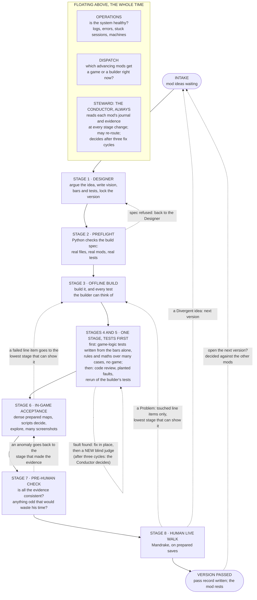

# The Maturation Pipeline

**Design Version 0.1.0 of the pipeline itself. DRAFT for Mandrake to argue with, 2026-11-13. Nothing here is built.** He answered the six questions that blocked the pilot on the evening of 2026-11-13 (by card, two of them typed); those answers are written into this draft and listed in §8 as "Decided". Everything else marked [PROPOSAL] is still not his.

Item: `RIMMANDRAKE_DESIGN_MATURATION_PIPELINE_WHOLE_MOD_IS_THE_UNIT`.
Live status page: `D:\ClaudeWork\rimmandrake\conductor\MATURATION_NOW.md` (where each mod stands today).

## How to read this

Every statement carries one of three marks.

| mark | meaning |
|---|---|
| **[HIS]** | Mandrake's own words, quoted and dated, or a thing he agreed to in words quoted here. |
| **[CARRIED]** | Already ruled by him earlier. The ruling is cited. Nothing new is decided. |
| **[PROPOSAL]** | An agent's suggestion. It is not his until he says so. Where the Conductor and this writer disagree, both views are given. |

In a table, the mark in a row's last column covers the whole row.

Words used here:

- **Mod**: one RimMandrake mod, for example Explosive Knockback.
- **Design Version**: the numbered design a mod is being built towards, for example 0.1.0. [CARRIED: his ruling of 2026-11-13, `design/RimMandrake/standing_rulings.md`, "Mod Design Versions use Semantic Versioning".]
- **Bar**: one thing that must be true for a version to pass. An acceptance criterion.
- **Line item**: one bar together with the one test that decides it. It has an id, the files it reads, and a stored verdict. [CARRIED: `design/RimMandrake/validation_map_and_rules.md`, "Words used throughout".]
- **Blind judge**: a fresh agent that did not do the work and is not told what an earlier judge found.
- **Offline**: without a running game. **In-game**: through a running RimWorld.
- **The two games**: the RimWorld on Archmagi (his machine) and the RimWorld on SteveDesktop (the second machine, which runs the queue of scripted game tests).
- **RimFlow**: the ticket ledger. It stays. It is not the pipeline.

---

## 1. His words

**[HIS] 2026-11-13, afternoon (Pacific), typed to the Conductor. One message, verbatim.**

> Ok, I'm with you. Yes, we're going to do what you recommend. But we need to do much more too. This is becoming a new Pipeline, much better than Relentless Pipeline. And boy do I need a beautiful Markdown to see how its phases all relate to each other, which Mod is where in the process, etc. This isn't a ticket tracking system I'm describing, that's RimFlow, and it certainly isn't going to just "take the next ticket" and work it. It is a Maturation Pipeline with a work unit that's a whole versioned Mod. We need to show how many "new mod ideas" we have waiting to process (maybe zero at this time, maybe not, they're all trapped in tickets). Then there's the Designer whose job it is to talk with us until we create a well defined series of specifications and acceptance criteria to "some level" we will be tuning for quite awhile likely. Within the Designer are those 1-5 steps you showed me. That really should be more like a "Stage 1" of the pipeline. AFTER that should be a Stage 2 that's the "preflight" to judge the build specification that comes out of designer, real files, real mods, real acceptance tests, Pythonic. Then a Stage 3 that's offline Build/implement including all testing it can think to perform itself. Then a Stage 4 that's offline blind code review, mutation-type coverage challenges, and verification of test outputs/rerunning plus judgement. If it finds issues, it should FIX THEM RIGHT THERE and force the system to pass, but then send it back to just before Stage 4 again for a new blind judgement pass, and these cycles should be tracked on the work item so we can monitor a cycling ticket. Stage 5 should be Offline game logic testing in all its many forms [question, is this really different than Stage 4, or should it be folded in?], with the same "Once you make your list of what's wrong, you're the one who should fix it RIGHT NOW and show it working... then send it back to a new blind you to start again for judgement." Stage 6: In-game acceptance testing with setup maps, proper acceptance testing, and using the fastest methods available with dense, rich setups that test many items simultaneously + allowances to explore beyond the acceptance tests and plentiful screenshots to look for "strange unexpected things." Stage 7: Final pre-human check to examine all the evidence as not merely sufficient but consistent and not containing obvious anomalies beyond the stated goals that would waste a human's review time. Stage 8: Human live-walk of prepared sittings, savegames, maps, etc. The whole time, floating above: Operations monitoring the functioning of the system, the flow of items, logfiles, lack of errors, resources, no idle/stuck sessions or machines, etc. as before. Dispatch ensuring timely execution of processing and agents, closing of finished agents, as before. Except that dispatch isn't working "by the ticket" anymore. It instead knows which Mods we are currently advancing and is opportunistically allowing them access to the two live games or offline builders/fixers as they currently need as they move through the system. This... is my attempt to describe what I've been trying to do with you 1-on-1 this whole time. But I feel like every time we write this up and implement it, it loses so much intelligence. How can we preserve that extremely productive interaction I enjoy when I work with you tightly like I'm doing right now? When we spot things together? Should Conductor (or something like Conductor) be floating over the process more regularly, taking in the status of items, peeking in on live game runs or findings, remembering the "beyond this one moment" context to recognize problems, etc? I feel like that might be a piece of this as well. In a nutshell: does this Pipeline idea look good? Relentless pipeline is done, we're not going back to that idea. But we need a pipeline. This looks like a more "Artisan-inspired" Pipeline concept. What do you think?

**[HIS] Earlier in the same sitting, verbatim.**

> I had thought it would be useful to go through the Designer on each of these mods until we have a very well designed set of definitions (we should already be very close) and acceptance tests (that's what we need to produce).

> can't we actually simulate that settings check offline? That seems a gratuitous use of the game, unless that's actually a very fast check?

**What "what you recommend" refers to.** Just before his message the Conductor had recommended six things. His "Yes, we're going to do what you recommend" makes them **[HIS] by agreement**; the wording of each is the Conductor's:

1. Lock the five mods now in the Designer as Design Version 0.1.0, as they stand.
2. Hold the scheduled Designer judge loop on those five.
3. Make every bar a runnable test, tagged with the stage that proves it, checked mechanically at lock.
4. Fold his held look statements in as bars. (These are the 66 things he said during live looks on 2026-11-12 and 2026-11-13, kept in `design/RimMandrake/validation_holding/`.)
5. Keep the Designer for arguing ideas and edges.
6. Pilot on Explosive Knockback first.

His full message is also kept at `D:\ClaudeWork\rimmandrake\conductor\maturation_pipeline_20261113\OWNER_WORDS.md`.

---

## 2. The idea in ten lines

1. **[HIS]** The pipeline moves **whole versioned mods**, not tickets. Tickets stay in RimFlow.
2. **[HIS]** Ideas wait at an intake. A mod then passes eight stages: Designer, preflight, offline build, offline blind challenge, offline game-logic testing, in-game acceptance, pre-human check, human live walk. **[HIS, by card 2026-11-13]** Stages 4 and 5 run as one stage, tests first (§8, decision 1).
3. **[HIS]** A judge that finds a fault at Stages 4 and 5 fixes it at once, shows it working, and hands the mod to a **new** blind judge. The cycles are counted on the mod. **[HIS, 2026-11-13]** After three cycles the Conductor decides what to do, and he confirms or changes it when he is next available (§8, decision 3).
4. **[HIS]** Operations and Dispatch float above. Dispatch knows which mods are advancing and gives them the two games and the offline builders as they need them.
5. **[CARRIED]** The target holds still: a mod is built towards a locked Design Version. A change that shifts the vision goes to the next version. (His ruling of 2026-11-13.)
6. **[CARRIED]** An objection sends back only the line items it touches, to the lowest stage that can show the fault. (Rule 2 of `validation_map_and_rules.md`, his card answer of 2026-11-12.)
7. **[PROPOSAL]** The mod is the unit that flows. The line item is the unit that is re-tested.
8. **[HIS, by card 2026-11-13]** The **steward** is the Conductor, always. **[PROPOSAL]** Each mod has a **journal file**; the Conductor reads the evidence at every stage change and the journal holds the memory. This is the answer offered to "how do we preserve the intelligence".
9. **[HIS, 2026-11-13]** He may look at any stage, and questions may be sent to him at any time; the Conductor lets him know (§8, decision 5). **[PROPOSAL]** An early look produces line items like any other.
10. **[HIS, by agreement]** It is done by hand on Explosive Knockback first. **[PROPOSAL]** Only what proved boring by hand gets automated.

---

## 3. The map

Stage numbers are his. The dotted arrows are the roads back.



Plain-text version of the same map:

```
  FLOATING ABOVE, THE WHOLE TIME
  ┌──────────────────────┬─────────────────────────────┬──────────────────────────────────┐
  │ OPERATIONS           │ DISPATCH                    │ STEWARD: THE CONDUCTOR, ALWAYS   │
  │ is the system        │ which advancing mods get a  │ reads each mod's journal and     │
  │ healthy?             │ game or a builder now?      │ evidence at every stage change   │
  └──────────────────────┴─────────────────────────────┴──────────────────────────────────┘

  INTAKE ──▶ 1 DESIGNER ──▶ 2 PREFLIGHT ──▶ 3 OFFLINE BUILD ──▶ 4+5 ONE STAGE, TESTS FIRST
  (ideas      (vision,       (Python,        (code + its own     (first: game-logic tests from the
   waiting)    bars, tests,   no model)       tests)              bars alone, many cases, no game;
               lock)                                              then: review, planted faults, reruns)
                  ▲               │                 ▲              │    ▲
                  └── refused ────┘                 │              └────┘
                                                    │           fix in place, NEW blind judge;
                                                    │           after three cycles the Conductor decides
                                                    │
  ──▶ 6 IN-GAME ACCEPTANCE ──▶ 7 PRE-HUMAN CHECK ──▶ 8 HUMAN LIVE WALK ──▶ VERSION PASSED
      (dense maps, scripts,     (is the evidence      (Mandrake, on          (pass record;
       explore, screenshots)     consistent?)          prepared saves)        the mod rests)
            │                        │                      │
            │                        │                      ├── a Problem ──▶ touched line items only,
            └── failed line item ────┴── anomaly ───────────┘                to the LOWEST stage (3, 4+5
                goes to the lowest stage that can show it                    or 6) that can show it
                                                            └── a Divergent idea ──▶ next version ──▶ INTAKE
```

**[HIS]** the eight stages, their order, their numbers, the fix-in-place loop, Operations and Dispatch above. **[HIS, by card 2026-11-13]** Stages 4 and 5 as one stage, tests first; the steward is the Conductor, always; three cycles, then the Conductor decides.
**[CARRIED]** the roads back from 6, 7 and 8 (rule 2, "lowest stage, touched line items only"); the Divergent road (Design Versions ruling).
**[PROPOSAL]** keeping the numbers 6 to 8 unchanged after the merge (from the recommendation he answered; the card did not rule on numbering); the road from "passed" back to intake.

---

## 4. The stages, one table each

"Model tier" points at `infrastructure/agents/Agent_Policy.md` (the file that says which model does which work). The ladder is not repeated here.

"Tracked on the mod" means: written into the mod's own version record, so the status page can show it without asking anyone.

### Intake: ideas waiting

| | | mark |
|---|---|---|
| Purpose | Hold mod ideas, and mods that exist but have no locked design, until one is chosen to advance. Show how many are waiting. | HIS ("We need to show how many 'new mod ideas' we have waiting to process") |
| Who | Nobody works here. He and the Conductor choose what enters Stage 1. | PROPOSAL (from the Design Versions draft: opening work on a mod is weighed against the other mods) |
| Model tier | None. A list, read by a program. | PROPOSAL |
| Inputs | Today: 42 "first touch" Designer items in RimFlow (`python3 src/RimMandrake/Utils/owner_queue.py`, measured 2026-11-13 3:03 PM PST). Other ideas sit inside tickets and are not counted yet. | measured; "trapped in tickets" is HIS |
| Outputs | One line per waiting mod: its name, one sentence, whether code already exists. | PROPOSAL |
| Exit ("ready" means) | He or the Conductor picked it, and fewer mods are advancing than the limit (open question "How many mods advance at once"). | PROPOSAL |
| Road back | A mod can be put back at intake at any time. Nothing is lost: its folder stays. | PROPOSAL |
| Tracked on the mod | Date it arrived; date it was picked. | PROPOSAL |

### Stage 1: Designer

| | | mark |
|---|---|---|
| Purpose | "Talk with us until we create a well defined series of specifications and acceptance criteria", to a level that will be tuned over time. | HIS |
| Who | The Designer role (`src/RimMandrake/rimflow/roles/designer.md`), with him. Its inner steps (Read, Argue the idea, Argue the edge, Write, Exam, Lock) live inside this stage. | HIS ("Within the Designer are those 1-5 steps... more like a 'Stage 1'") |
| Model tier | Judgment work: see Agent_Policy.md, "The one question". | CARRIED |
| Inputs | The idea. His words. If any code exists: a live walk of what exists, before more design is added. | CARRIED (his ruling 2026-11-12 5:06 PM PST, rule 7 of `validation_map_and_rules.md`) |
| Outputs | The mod's version folder: a short vision, the bars, and for every bar **one test, with the stage that proves it**. Also the next-version file and the Polish list. | HIS by agreement (recommendation 3); folder layout CARRIED from the Design Versions ruling |
| Exit ("ready" means) | He said "lock it" for this version. Every bar names its test and its stage. Each test runs (a built mod) or is specified (a new mod). | CARRIED (Design Versions: locked on his word); test-per-bar HIS by agreement; runs or specified HIS by card 2026-11-13 |
| Road back | Stage 2 refuses the spec: back here for the refused lines only. After the lock, a Divergent idea never comes back here in this version; it opens the next one. | CARRIED (rule 2; Design Versions ruling) |
| Tracked on the mod | Version number; state (drafting, locked); count of bars; tokens spent; his open questions. | CARRIED (Design Versions draft §3.7) |

**What a test must be at the lock.** **[HIS, by card 2026-11-13]** "Built: runs. New: specified." For a mod whose code exists, every bar's test runs at the lock. For a new mod, every bar's test is specified at the lock (a test id, its stage, the file it will live in, what it will observe, the files it reads; Stage 2 checks that mechanically) and Stage 3 makes each one run, failing first.

One proposal inside Stage 1 is big enough to be an open question: whether the Designer's Exam and coverage judge stay as gates (open question 7).

### Stage 2: Preflight

| | | mark |
|---|---|---|
| Purpose | "Judge the build specification that comes out of designer, real files, real mods, real acceptance tests, Pythonic." Stop a spec that cannot be built or tested before a token is spent on building it. | HIS |
| Who | A Python program. No model. | CARRIED (his ruling 2026-11-12 3:18 PM PST: "Before a single token is spent, a deterministic python script should confirm everything it can") |
| Model tier | None. | CARRIED |
| Inputs | The locked version folder; the repo; the list of every def in the game; the mod lists. | CARRIED (spec `design/specs/2026-11-12-ticket-preflight-before-any-token.md`) |
| Outputs | A preflight record: each check, pass or refuse, the smallest fix for each refusal, and how long the run took. | CARRIED (same spec; "the precise time this took to run" is his) |
| Exit ("ready" means) | Every named file, def and mod is real. Every bar has a test. Every test names its stage. Every test that needs the game says why an offline test cannot decide it. Every test that needs the full mod list says why. Every held look statement for this mod has been placed. | First two CARRIED; "every bar has a test" HIS by agreement; "says why the game is needed" PROPOSAL (agreed by the Conductor and this writer, see below); full-list reason CARRIED (his 2026-11-12 ruling); held statements PROPOSAL |
| Road back | A refusal names the line and the fix. A wrong fact goes back to Stage 1. A broken criterion goes to the neutral fixer (a fresh agent that repairs acceptance criteria and is neither the judge nor the builder). | CARRIED (his refusal ruling 2026-11-12 2:50 PM PST) |
| Tracked on the mod | Last preflight time and duration; refusals open. | PROPOSAL |

**On "the cheapest stage that can decide it".** The Conductor proposes that preflight checks this mechanically. This writer agrees in part. Python can check that a stage is *declared* and that a game-stage test carries a *written reason*. Python cannot check that the reason is *true*. That part is judgment, and it belongs to the Stage 4 challenger, who is asked one extra question per game-stage test: "could a faster test decide this?" His settings question of today ("can't we actually simulate that settings check offline?") is exactly that question. **[PROPOSAL]**

### Stage 3: Offline build

| | | mark |
|---|---|---|
| Purpose | "Offline Build/implement including all testing it can think to perform itself." | HIS |
| Who | Builder agents, one RimFlow ticket at a time, inside this mod. | HIS (tickets stay in RimFlow); PROPOSAL (tickets are the work inside the mod's current stage) |
| Model tier | Per ticket: see Agent_Policy.md, "The ladder" and "Helpers in this repo". | CARRIED |
| Inputs | The locked version; the preflight record. | PROPOSAL |
| Outputs | Code, defs, art. For each bar, its offline test and its in-game test, each watched failing before the code made it pass. Review status clean. | CARRIED (his ruling 2026-11-13: "we build the test at the same time as the item, both offline and online versions") |
| Exit ("ready" means) | Every bar's offline test passes. Every in-game test exists and is listed with its exact command, even though it has not run. The builder's own list of what it could not test is written down. | PROPOSAL |
| Road back | None of its own. Faults found later arrive here as line items. | CARRIED (rule 2) |
| Tracked on the mod | Tickets open and done in this stage; bars with a passing offline test, of total; tokens. | PROPOSAL |

For a mod that is already built (all five current mods), Stage 3 is not "build". It is "reconcile": check each locked bar against what exists, and build only the missing tests and the missing pieces. **[PROPOSAL]**

### Stages 4 and 5: Blind offline challenge and game-logic testing, one stage, tests first

**[HIS, by card 2026-11-13]** "One stage, tests first." His question "is this really different than Stage 4, or should it be folded in?" is answered: one stage. The independence two stages would have bought is kept by order: the blind agent writes and runs its own game-logic tests from the bars alone, before it opens the builder's code or tests, and only then does the code challenge. One load of the mod, one cycle, independent tests. The two parts are reported as two lanes so the pilot can count what each finds. **[PROPOSAL]** the stage keeps the label "Stages 4 and 5", so that his numbers 6 to 8 do not move.

| | | mark |
|---|---|---|
| Purpose | Stage 4: "Offline blind code review, mutation-type coverage challenges, and verification of test outputs/rerunning plus judgement." Stage 5: "Offline game logic testing in all its many forms." In plain words: are the mod's rules and maths right over thousands of cases without the game; does the code do what it claims; can the tests actually fail; do the builder's test results repeat? | HIS |
| Who | A fresh agent that did not build the mod and is not told what any earlier judge found. | HIS ("a new blind judgement pass"; "send it back to a new blind you") |
| Model tier | A judging role: see Agent_Policy.md, "Four places a cheaper tier is forbidden outright". | CARRIED |
| Order | First, with only the locked bars, the code's logic kernels (the game-free core of a mod's rules) and the mod's settings as shipped: write the game-logic tests and run them. Then open the code, the builder's tests and their recorded outputs for the review, planted faults and reruns. | HIS, by card ("tests first"); the exact inputs per part PROPOSAL |
| Outputs | Lane 1 (game logic): test rows; random cases with the failing case shrunk to its smallest form; conservation checks (nothing created or lost); the shipped settings swept through their ranges. Lane 2 (challenge): a list of faults, each as detailed as the evidence, saying what would pass and naming the smallest fix; planted-fault results (a planted fault is a deliberate bug put in to see whether a test catches it); rerun results. | Lane 1 CARRIED (kept schemes, his picks of 2026-11-12: kernels with random cases, shipped-settings sweep with conservation laws); lane 2 HIS for the content, record shape CARRIED (refusal ruling 2026-11-12) |
| Exit ("ready" means) | Every bar tagged "offline" is green. A blind judge found nothing that is a Problem. | PROPOSAL (Problem versus Polish is CARRIED from his card of 2026-11-13) |
| Road back | "If it finds issues, it should FIX THEM RIGHT THERE and force the system to pass, but then send it back to just before Stage 4 again for a new blind judgement pass." "Once you make your list of what's wrong, you're the one who should fix it RIGHT NOW and show it working... then send it back to a new blind you." | HIS |
| What the next blind judge reads | **"All once, then changes."** The first judge reads everything. After a fix, the new judge reads the changed files and the line items whose inputs changed, without being told what the last judge found. A fault found late in unchanged material is still fixed, and is logged as a miss of the first judge. | HIS, by card 2026-11-13 |
| Tracked on the mod | "These cycles should be tracked on the work item so we can monitor a cycling ticket": the cycle count, and per cycle what each lane found, what was fixed, which tests were edited, tokens; lane 1 rows passing of total. | HIS for the count; detail PROPOSAL |

**Guards on fix-in-place.** **[PROPOSAL]** from the Conductor; this writer agrees and adds the last one.

- The fixer may not edit a bar or an acceptance criterion. A wrong criterion goes to the neutral fixer. (This part is [CARRIED], his refusal ruling.)
- Every test the fixer edits is listed in the cycle record and shown to the next blind judge. Otherwise "force the system to pass" could be done by weakening a test.
- Added by this writer: each fix is shown red first. The fixer records the test failing on the old code, then passing on the new. "Show it working" is his phrase; red-first is how it is shown.

**After three cycles.** **[HIS, 2026-11-13, typed]** "After three cycles, Conductor is brought in (Fable 5.2 class reasoner) to make a decision on what to do. When the user is next available, they are informed and the decision is confirmed or changes made. Conductor may choose any of the options you offered, or yet more creative ones (it may see how to fix the problem in a way the judges did not)." The options offered were: defer a bar, repair a criterion, call it a design fault, or allow one more cycle. Cycles are counted on the mod; a fourth judge never starts on its own.

### Stage 6: In-game acceptance

| | | mark |
|---|---|---|
| Purpose | "In-game acceptance testing with setup maps, proper acceptance testing, and using the fastest methods available with dense, rich setups that test many items simultaneously + allowances to explore beyond the acceptance tests and plentiful screenshots to look for 'strange unexpected things.'" | HIS |
| Who | A live-test agent driving one of the two games. Scripts give the verdict on each bar; the agent explores and looks. | HIS for the stage; "scripts decide" CARRIED from the old map's stage 4 (not his by card) |
| Model tier | A live driver: see Agent_Policy.md, "Helpers in this repo". | CARRIED |
| Inputs | The mod as deployed to the game; the in-game tests from Stage 3; a prepared map built by the mod's own proof script. | CARRIED (rule 5: dense, labelled savegame on matrix scenes, his words of 2026-11-12) |
| Outputs | One verdict per in-game line item. Screenshots. A list of strange things seen that no bar covers. A labelled savegame. | HIS |
| Exit ("ready" means) | Every in-game line item passes on a site that was checked first (open sky, no stray animals). Every strange thing is either explained or filed. The savegame for him exists. | CARRIED (rule 6: "a site is asserted, never hoped", his words 2026-11-12) plus PROPOSAL |
| Road back | A failed line item goes to the lowest stage that can show the fault, and an offline test that fails on the old code is written first. Only that line item and those sharing its inputs are re-run. | CARRIED (rules 2c and 2d) |
| Tracked on the mod | Rows pass, fail and unmeasured; which game; wall time; strange things open. | PROPOSAL |

The fastest methods: the 13-mod minimal list loads in 22 seconds; the full list takes about 15 minutes. A test uses the full list only when it says why. **[CARRIED]** (his ruling 2026-11-12). A flyer's flight is never tested live without him. **[CARRIED]**

### Stage 7: Pre-human check

| | | mark |
|---|---|---|
| Purpose | "Examine all the evidence as not merely sufficient but consistent and not containing obvious anomalies beyond the stated goals that would waste a human's review time." | HIS |
| Who | A fresh reader that made none of the evidence. | CARRIED (user-level rule, 2026-10-22: "Read it first and see if it's obviously broken... before wasting a human's time") |
| Model tier | A judging role, as Stage 4. | CARRIED |
| Inputs | Everything from stages 2 to 6: records, test rows, screenshots, the savegame. | PROPOSAL |
| Outputs | One short verdict. A list headed "known, not fixed: you need not report these". The brief for his walk: what to open, what to look at, what changed since his last look. | CARRIED (rule 4; "changed since your last look" is his card of 2026-11-12) |
| Exit ("ready" means) | No two pieces of evidence contradict each other. Nothing obviously odd is left unexplained. The walk is prepared and ranked: the things only he can judge come first. | PROPOSAL |
| Road back | An anomaly goes back to the stage that made the evidence, as a line item. | CARRIED (rule 2) |
| Tracked on the mod | Arrivals at this stage. Each arrival is one release candidate: 0.1.0-rc.1, 0.1.0-rc.2. | CARRIED ("A judge round is a release candidate") with a PROPOSAL about what counts as a round (open question) |

### Stage 8: Human live walk

| | | mark |
|---|---|---|
| Purpose | "Human live-walk of prepared sittings, savegames, maps, etc." | HIS |
| Who | Mandrake. | HIS |
| Model tier | None. An agent may sit with him to stage and record. | PROPOSAL |
| Inputs | The Stage 7 brief; a dense, labelled savegame. | CARRIED (rule 5) |
| Outputs | His words, verbatim, in the ledger. Each thing he says becomes one line item with a class: mod fault, test-map fault, test-tool fault, art, new bar, or question. Each pass he gives is pinned. | CARRIED (rules 2a and 2e) |
| Exit ("ready" means) | He passes the version. The pass record is written: date, git commit, bars, evidence, cost, cycles. | CARRIED (Design Versions draft §3.7); the pass is his alone |
| Road back | A Problem (a defect, or something a player would reject as strange or disappointing) stays in this version and goes to the lowest stage that can show it. Polish goes to the mod's Polish list, confirmed with him. A Divergent idea goes to the next version. His objection closes only on his own later look, as a labelled cell in the next save he opens anyway. | CARRIED (his cards of 2026-11-13 and 2026-11-12) |
| Tracked on the mod | His minutes; objections by class; pinned passes; the pass record. | PROPOSAL |

---

## 5. Floating above

### Operations

**[HIS]** "Operations monitoring the functioning of the system, the flow of items, logfiles, lack of errors, resources, no idle/stuck sessions or machines, etc. as before."

Nothing changes in what Operations watches. **[PROPOSAL]** One thing is added to its list: a mod whose stage has not moved for longer than that stage's usual time is "stuck", and is reported the same way a stuck session is.

### Dispatch

**[HIS]** "Dispatch ensuring timely execution of processing and agents, closing of finished agents, as before. Except that dispatch isn't working 'by the ticket' anymore. It instead knows which Mods we are currently advancing and is opportunistically allowing them access to the two live games or offline builders/fixers as they currently need as they move through the system."

**[PROPOSAL]** What replaces "take the next ticket":

- Dispatch holds a short list of **advancing mods**. Everything else waits at intake or rests.
- For each advancing mod it asks one question: what does this mod's current stage need right now? A game, an offline builder, a blind judge, or him.
- The two games are the narrow point. A mod at Stage 6 waits for a game; a mod at Stage 8 waits for him and for the game on his machine. Offline stages never wait for a game.
- Inside a stage, the work is still tickets in RimFlow. The stage's worker picks among that mod's tickets. Nobody picks among all tickets of all mods.
- Work that belongs to no mod (tools, infrastructure) stays ticket work as today. A tool ticket that blocks an advancing mod takes that mod's urgency. (Open question "Tickets that belong to no mod".)

### The steward and the journal

**[HIS]** "How can we preserve that extremely productive interaction I enjoy when I work with you tightly like I'm doing right now? When we spot things together? Should Conductor (or something like Conductor) be floating over the process more regularly, taking in the status of items, peeking in on live game runs or findings, remembering the 'beyond this one moment' context to recognize problems, etc?"

**[PROPOSAL] Where the intelligence is lost** (the Conductor's reading; this writer agrees):

- A gate replaced a judgment. A gate can only say yes or no to the question it was built with.
- Each agent saw one slice at one moment. Nobody held the whole mod in mind across days.
- Machinery was built before the work had been done once by hand.

Today's measured example: the Designer loop on Explosive Knockback charged about 97 million tokens to its stage record without its judge ever passing, and its last six gaps were one-line paper edits. (Of that total, 86.5 million are estimates entered as "unmeasured" charges and 10.7 million are measured; source `design/concepts/ExplosiveKnockback/version/VERSION.json`.) By the Designer's own inner steps: 54 million in Write, 34 million in Exam, 8.5 million in Lock, which includes the judge. No single agent in that loop was in a position to say "this is silly".

**[HIS, by card 2026-11-13] The steward is the Conductor, always.** Not a standing seat per mod, and not a duty handed to any fresh agent. **[PROPOSAL]** for the rest of this list (the Conductor's proposal):

- The steward reads the evidence at **every stage change**. It may look in on live runs. It is allowed to say "this is silly" and re-route the mod. It brings him short, ranked sittings.
- Judgment lives at the stage changes. The plumbing between them is automated.
- Each mod has a **journal**: one file with the vision, his words, the history, the oddities, and what was tried. The memory lives in the journal, not in any agent's context window, so it survives a restart.

**The cost, named.** A steward is a reader that floats. Every stage change costs one read of the journal and of the new evidence. Bounds proposed by the Conductor: the steward reads summaries and records, not raw logs; it acts at stage changes and at alarms, not on a timer.

**Where this writer disagrees with the Conductor, or adds:**

1. **The journal is what keeps the Conductor from becoming the memory.** The steward is now always the Conductor (his card). The journal must still be complete enough that a restarted Conductor can do one stage change from the journal alone; that is the test of the journal.
2. **The journal needs a shape or it becomes one more stale file.** Proposal: a top part of at most two screens, "the mod as it stands", rewritten at each stage change; below it, a dated history that is only added to. At each Stage 8 the top part is read to him. He is the only one who can say the picture of his mod is wrong.
3. **A steward does not replace him spotting things.** What he describes as productive is a short loop: he looks, says something, and it changes while he is still there. Eight stages make that loop longer. **[HIS, 2026-11-13, typed]** "Yes, at any stage, and questions can be sent to the user at any time. If I can get to them, I might be able to steer out of a coming confusion early. Conductor will let me know." So the Conductor offers him a look at any stage and sends him questions as they arise, without waiting for Stage 8. Stage 8 is the formal walk, not the first time he sees the mod. (This extends his Designer ruling of 2026-11-12: "If we can insert an owner quick-look to settle a difficult or several questions swiftly, offer that loudly".)
4. **Live looks must feed the design.** Today the Designer loop ran on paper beside the hands-on work, and what he saw in the game never reached its scenes (measured by the Conductor today). Proposal: every look, early or formal, writes its line items into the same version folder the Designer locked. There is one list of bars per version, not a paper one and a hands-on one.

---

## 6. Flow and re-testing: two different units

**[PROPOSAL]** from the Conductor; this writer agrees.

- **The unit of flow is the versioned mod.** The status page shows mods, not tickets.
- **The unit of re-testing is the line item.** When something sends work back, only the touched line items and those sharing their inputs are re-run. Every other stored pass stands. [CARRIED: rule 2d, his card of 2026-11-12: "Piecemeal revalidation of specific touched line items is crucial".]
- **Tickets stay in RimFlow.** A ticket is a piece of work inside a mod's current stage. [HIS: "This isn't a ticket tracking system I'm describing, that's RimFlow".]
- **A Problem fix stays in the version.** A Polish idea goes to the Polish list. A Divergent change goes to the next version and enters at Stage 1. [CARRIED: his rulings and cards of 2026-11-13.]
- **A PATCH** (a small correction after a pass, the third number of the version) re-tests only its touched line items and takes the light path. [CARRIED for the meaning of PATCH; the light path is the open question "The light path".]

**What is tracked on each mod**, in one record beside its version file. **[PROPOSAL]**

| field | example |
|---|---|
| Design Version and state | 0.1.0, locked |
| Stage now, and since when | Stage 4, since 2026-11-14 10:20 PST |
| What it is waiting on | a game / a builder / a blind judge / Mandrake / nothing |
| Bars: total, with a test, passing at each stage | 59 / 59 / 51 offline, 0 in game |
| Cycles at Stages 4 and 5 | 2 |
| Release candidate number | rc.1 |
| Cost per stage | tokens, wall time, his minutes |
| Held items: Polish list size, next-version file size | 0, 1 |

---

## 7. How the earlier maps fit onto this one

### The earlier stage map, 0 to 6 (`design/RimMandrake/validation_map_and_rules.md`, 2026-11-12)

| earlier stage | what it was | where it goes now | mark |
|---|---|---|---|
| door 0, Preflight | Python checks a ticket before any token | Stage 2, for the whole mod's build spec. The per-ticket check stays as a door on each ticket inside a stage. | HIS (Stage 2) / CARRIED |
| 1, Agree | the bars are written and he signed | Stage 1 | HIS |
| 2, Code check | selftests, lints, review, planted faults | Split. The builder's own checks are Stage 3. The blind review and the planted-fault challenge are Stage 4. | HIS |
| 3, Logic off-game | kernels, random cases, conservation | Split. Writing them is Stage 3. Running and challenging them blind is the first part of Stages 4 and 5, before the code is opened. | HIS; the order HIS by card 2026-11-13 |
| 4, In-game proof | a script's verdict through the game | Stage 6 | HIS |
| 5, Pre-look | a fresh judge on the scene and the art | Stage 7. The looking at screenshots during the test itself is Stage 6. | HIS |
| 6, Owner look | Mandrake on a labelled save | Stage 8 | HIS |

**Retired by this map, if he accepts it:** the 0 to 6 numbers. The file keeps its rules and gets a banner pointing here. **[PROPOSAL]**

### The twelve rules of the earlier map all carry over

| rule | one line | where it lives now | mark |
|---|---|---|---|
| 1 | Mechanism work is done on the script's verdict; work with a look goes on to him | Stage 6 closes mechanism line items. Stage 8 shows him look items, and anything he asks for. | CARRIED (his card 2026-11-12) |
| 2 | An objection becomes line items; each re-enters at the lowest stage that can show it; only touched line items re-run; his passes are pinned; his objections close on his look | The roads back from 6, 7 and 8 | CARRIED (his cards 2026-11-12) |
| 3 | A refusal carries its fix path; a broken criterion goes to a neutral fixer at once | Every judge at Stages 4 and 5 and at Stage 7; preflight refusals at Stage 2 | CARRIED (his ruling 2026-11-12) |
| 4 | Nothing reaches him unread; unfixed findings are listed first | Stage 7 | CARRIED |
| 5 | The first human look is a dense, labelled savegame on matrix scenes (one prepared cell copied across the variables that matter) | Built in Stage 6, used in Stage 8 | CARRIED (his words 2026-11-12) |
| 6 | A test site is checked, never hoped | Stage 6, before any row counts | CARRIED |
| 7 | When code exists, walk it live before designing more | Stage 1 input; and the early look | CARRIED |
| 8 | Check everything Python can before a token is spent | Stage 2 | CARRIED |
| 9 | A gate that is always red is not a gate (the nightly sweep) | Operations | CARRIED |
| 10 | Publish runs the fast whole-tree checks and refuses on a red | unchanged, outside the pipeline | CARRIED |
| 11 | A flyer's flight state may be read paused, without him | Stage 6, for flyers; flight itself is Stage 8 only | CARRIED |
| 12 | A defect he reports in a look is stored until the ladder is regenerated, then ingested | The store is `design/RimMandrake/validation_holding/`. Ingest is agreed (recommendation 4). When and how: open question "When the held look statements are ingested". | CARRIED / HIS by agreement |

### The Designer's inner steps

| Designer step | what it does | in the pipeline | mark |
|---|---|---|---|
| Read | take stock of what exists | Stage 1 | HIS |
| Argue the idea | agree the root idea with him | Stage 1 | HIS |
| Argue the edge | settle the edge cases with him | Stage 1 | HIS |
| Write | write the sheet, the tree of bars, the scenes | Stage 1. Its output gains the test-and-stage table. | HIS / HIS by agreement |
| Exam | fresh readers answer questions from the written design | Stage 1. Whether it stays a gate is open question 7. | PROPOSAL |
| Lock | a coverage judge, then the lock | Stage 1's exit. The scheduled judge loop is on hold for the five mods (recommendation 2). On Explosive Knockback the lock was made on his word (commit eab59259ec added that signature). | HIS by agreement |

### Design Versions

| Design Versions idea | in the pipeline | mark |
|---|---|---|
| A version is a locked vision, bars and tests | Stage 1's exit | CARRIED |
| Problem stays, Polish goes to the Polish list | every road back, and the exit of Stages 4 and 5 and of Stage 7 | CARRIED (his card 2026-11-13) |
| Divergent goes to the next version | the road from Stage 8, or from any stage, to intake | CARRIED |
| The now-or-next question is asked at filing | whenever a line item is written, at any stage | CARRIED (his card 2026-11-13) |
| A judge round is a release candidate, rc.N | each arrival at Stage 7 | CARRIED; "what counts" is PROPOSAL |
| A judge may propose deferring a bar that keeps failing on weak evidence; the Conductor approves, he sees it after | the Conductor (the steward), after three cycles; he confirms or changes it when next available | CARRIED (his card 2026-11-13) |
| Pass record; passed tests become regression tests for later versions | after Stage 8 | PROPOSAL (Design Versions draft §3.7, not yet ruled) |

### The kept validation schemes

From the inventory of 2026-11-12 (`design/RimMandrake/validation_inventory_2026-11-12.md`, 55 schemes) and his picks of the same day. **[CARRIED]** for which schemes are kept; **[PROPOSAL]** for the stage each lands in.

| scheme | stage |
|---|---|
| Ticket preflight | 2, and a door on every ticket |
| North-star checklist (the signed list of what a player must and must never see) | 1 |
| Targeted selftests, def and patch lints, code review status, commit hooks | 3 |
| Second-model review, planted faults, mutation testing, replay of recorded test outputs | 4 |
| Logic kernels with random cases, parity between the C# and Python versions, geometry libraries, shipped-settings sweep with conservation laws | written in 3, challenged in 5 |
| Load checks, each mod's in-game script, north-star suites and driver, shared scene runner, matrix scenes, the one refusing gate | 6 |
| Open and checklist pre-look judges, the frame judge, prereview record | 7 |
| Art evaluation and offline art checks | see the open question "Where art sits" |
| Owner sittings, keeper saves, review sheets, the first-look savegame | 8 |
| Test Pilot (one live debugging sitting on a stubborn fault) | beside Stage 6, when a line item keeps failing in game |
| Findings judge, proof cost ledger | Operations |

### What this map retires or deletes

All **[PROPOSAL]** except where marked. Nothing is deleted by this document.

- The Relentless pipeline. **[HIS]** "Relentless pipeline is done, we're not going back to that idea." Its deletion scope was already written on 2026-11-12. Whittle and Relentless stay switched off (his words of 2026-11-13: "No Whittle, Relentless please. Those aren't validated yet.").
- "Take the next ticket" as the way mod work is chosen. **[HIS]**
- The 0 to 6 stage numbers.
- The older level words (L0 to L4, GREEN-MIN, GREEN-FULL) as stage names. Retiring them was already proposed in the earlier map and is still not his.
- The Designer's scheduled judge loop after a lock. **[HIS by agreement]** for the five mods; as a general rule it is a proposal.
- The first-touch items' wording "write it out for Relentless as build items".

---

## 8. Questions for him

Six questions blocked the pilot. He answered all six on the evening of 2026-11-13, four by card and two typed (recorded on `RIMMANDRAKE_DESIGN_MATURATION_PIPELINE_WHOLE_MOD_IS_THE_UNIT`), and each answer is written into the sections above. Questions 7 to 17 are still open; they can wait until the pilot has shown something.

### Decided, 2026-11-13

**1. Stage 4 and Stage 5: one stage or two?** **[HIS, by card]** "One stage, tests first." The blind agent first writes and runs its own game-logic tests from the bars alone, then opens the builder's code and tests for the challenge. One load of the mod, one cycle, two reported lanes. (§4, "Stages 4 and 5".)

**2. After a fix, does the new blind judge read everything, or only what changed?** **[HIS, by card]** "All once, then changes." The first judge reads everything. After that, each new judge reads the changed files and the line items whose inputs changed, without being told what the last judge found. A fault found late in unchanged material is still fixed, and is logged as a miss of the first judge.

**3. How many fix cycles, and then what?** **[HIS, typed]** "After three cycles, Conductor is brought in (Fable 5.2 class reasoner) to make a decision on what to do. When the user is next available, they are informed and the decision is confirmed or changes made. Conductor may choose any of the options you offered, or yet more creative ones (it may see how to fix the problem in a way the judges did not)." The options offered were: defer a bar, repair a criterion, call it a design fault, or allow one more cycle.

**4. Who is the steward?** **[HIS, by card]** "The Conductor, always." (§5, "The steward and the journal".)

**5. May he look early?** **[HIS, typed]** "(1) Yes, at any stage, and questions can be sent to the user at any time. If I can get to them, I might be able to steer out of a coming confusion early. Conductor will let me know."

**6. What must a test be at the lock?** **[HIS, by card]** "Built: runs. New: specified." A built mod's tests run at the lock. A new mod's tests are specified at the lock (id, stage, file, what it observes, files it reads) and made to run, failing first, in Stage 3. (§4, Stage 1.)

### Still open: after the pilot has shown something

**7. Do the Designer's Exam and coverage judge stay as gates before the lock?**

- *Keep both.* They are built. On Explosive Knockback they were charged 34 million and 8.5 million tokens and the judge never passed.
- *Drop both as gates.* The lock needs: preflight green, one cold read by a fresh reader, and his "lock it".
- *Keep the Exam for mods with no code, where there is nothing else to test the design against.*
- **Recommendation:** drop both as gates for built mods now; decide for unbuilt mods after the first one goes through.

**8. How do the 42 waiting mods enter?**

- *Each gets a full Designer first touch, as queued today.*
- *A built mod enters "as built": a short vision written from what exists, bars taken from its signed list and its existing tests, locked as 0.1.0 on his read, straight to Stage 2.* Most of the 42 already have code.
- *He ranks a handful; the rest wait at intake untouched.*
- **Recommendation:** he ranks five. Built mods among them enter as built. The 42 items stay filed and become the intake list.

**9. How many mods advance at once?**

- One, three or five.
- The trade: the narrow points are the two games and his own time. More mods advancing means more waiting at stages 6 and 8, and more half-finished work.
- **Recommendation:** one during the pilot, then three.

**10. The light path: what may a small change skip?**

- *Nothing; every version takes all eight stages.*
- *A PATCH takes: preflight on the touched lines, the fix, one blind challenge of the diff, the touched in-game rows, and then appears as a "changed since your last look" cell in the next save he opens anyway. No sitting of its own.*
- *A small mod with no art also lets the Conductor do Stage 7.*
- **Recommendation:** the second for a PATCH. Decide the third after the pilot.

**11. Where does art sit?**

- *In its own parallel pipeline that joins at Stage 6.* That is how it runs today.
- *As a lane of the same stages:* made in Stage 3; the existing art evaluation is its Stage 4 challenge; a true-scale review sheet goes to him only when the evaluation cannot decide; seen in the world at stages 6 to 8. An art bar is a line item like any other.
- **Recommendation:** the second, so that a mod's art cannot be "done" on a different clock from its code.

**12. When are the 66 held look statements ingested?** (Ingesting them is agreed.)

- *All now, in one pass.*
- *Per mod, when that mod reaches Stage 2.* Preflight refuses a mod whose held statements are not yet placed. Explosive Knockback's 2 go in during the pilot; the 64 from the FlowWorks pit looks go in when FlowWorks advances.
- His earlier ruling says they wait "until our validation ladder is fully defined and regenerated". So this also asks: **does accepting this map count as that?**
- **Recommendation:** per mod, and yes.

**13. What counts as a release candidate?**

- *Every blind judge run anywhere.* The number climbs fast and means little.
- *Each arrival at Stage 7.* It then means "the system thought this was ready for him".
- **Recommendation:** each arrival at Stage 7. Cycles at Stages 4 and 5 are counted separately.

**14. Tickets that belong to no mod.**

- *They stay ticket work in RimFlow, as today.*
- *Tools become versioned units in the same pipeline later.*
- **Recommendation:** the first for now.

**15. Does every version need a Stage 8 walk?**

- *Yes, always.*
- *A version with no look in it (mechanism only) closes on its script verdicts and a one-page pass record; he walks it only if he asks.* This is rule 1 of the earlier map.
- **Recommendation:** the second for a PATCH, the first for any 0.x.0 version.

**16. A second hand-run before anything in stages 6 to 8 is automated?**

- Explosive Knockback is a mechanism mod that is already built. It will exercise art, biome looks and a from-nothing build very little.
- **Recommendation:** yes. After Explosive Knockback, hand-run one look-heavy mod (Pyrelands, a biome with art) before automating the later stages. This is this writer's disagreement with a pilot of one.

**17. The deletion list in section 7.** Confirm, change or strike each line.

---

## 9. The pilot: Explosive Knockback, by hand

**[HIS by agreement]** that the pilot is Explosive Knockback. **[PROPOSAL]** for everything below, from the Conductor ("use it, break it, grow") with this writer's additions.

Where it starts (measured 2026-11-13 3:03 PM PST): the design is locked at 0.1.0 on his word. The mod's code exists (`src/RimMandrake/ExplosiveKnockback/`, with four selftests, an in-game script and three proof scripts). Its 59 bars are checklist rows; they are not yet a table of tests with stages. Six judge gaps are open, all corrections to test text, five of which the judge said "look fixed".

The steward is the Conductor (his card: "The Conductor, always"). No program is built for the pilot except throwaway scripts.

| step | what is done by hand | what is written down |
|---|---|---|
| Start the journal | One file: the vision, his words on this mod, today's history, the oddities. | The journal. |
| Finish Stage 1 | Turn the 59 bars into the test-and-stage table. Apply the six corrections. Place the 2 held statements. Move the settings sweep from the game to an offline test (his question of today). | The table; how many bars already had a runnable test. |
| Stage 2 | A throwaway script checks the table against the repo and the def list. | Refusals; the run time. |
| Stage 3, as "reconcile" | Build the missing tests, failing first. Build anything a bar needs that does not exist. | Tickets used; tokens. |
| Stages 4 and 5 | One fresh blind agent, tests first (§8, decision 1): its own game-logic tests from the bars, then the code. Fix in place. A new blind agent that reads the changes (decision 2). After three cycles the Conductor decides (decision 3). | Cycles; what each lane found; tests edited. |
| Stage 6 | One dense prepared map on the minimal mod list, on one game. Scripts decide. Screenshots. | Rows; strange things; wall time. |
| Stage 7 | One fresh reader over everything. | The walk brief. |
| Stage 8 | His walk. | His words; the pass record, or the list that sends it back. |

At every stage change the steward writes three things in the journal: what the stage cost (tokens, wall time, his minutes), what was boring enough to automate, and what needed judgment.

**Limits for the pilot. [PROPOSAL]** A budget for stages 1 to 7 is set before it starts and the pilot stops and comes to him at that number. This writer has no measured basis for the number; it should be far below the 97 million charged to the paper loop. The cycle limit of three (§8, decision 3) applies.

**What the pilot is not.** It does not test a from-nothing build, art, or a look-heavy mod. It does not prove the pipeline. It produces the first measured cost of one mod version from lock to his pass, and a list of what to automate.

**The pipeline's own bars for its version 0.1.0. [PROPOSAL]**

1. One mod version has gone from lock to his pass (or to an honest "superseded") with every stage change recorded.
2. He can see where every mod stands on one page that a program regenerates without tokens.
3. A stage that cycles is visible as a number, and stopped at the limit.
4. No bar was proven in the game that an offline test could have decided.
5. Each thing he objects to at Stage 8 is recorded with the earliest stage that could have caught it. That count is the pipeline's own measure of lost intelligence.

**Build order after the pilot. [PROPOSAL]**

1. The status page program (filed today; it reads files and costs no tokens).
2. The mod record of section 6, so the page has something to read.
3. The Stage 2 preflight for a mod, grown from the pilot's throwaway script.
4. Nothing else until the second hand-run says what is boring.

---

## 10. What this draft does not know

- The count of mod ideas that sit inside tickets and are not first-touch items: UNMEASURED. No marker says "this ticket is a mod idea".
- What a stage change costs the Conductor as steward: UNMEASURED until the pilot.
- His minutes per look: UNMEASURED.
- The Explosive Knockback judge-round count has three answers on disk and in today's notes: 12 by its version record, 13 judge-review charges in its stage record, 19 in the Conductor's sitting note. Not reconciled.
- Whether "Artisan-inspired" should mean more than is taken here. What this draft takes from Artisan (the loop method of 2026-11-07): his words are frozen and everything else belongs to the agents; the work unit is a whole piece, not a ticket; the finish line is something he would be shown; a fresh judge reads every claim. What it does not take: one unattended agent looping alone. Artisan's own record says zero acceptances as of 2026-11-07, so nothing here leans on it as proven.
