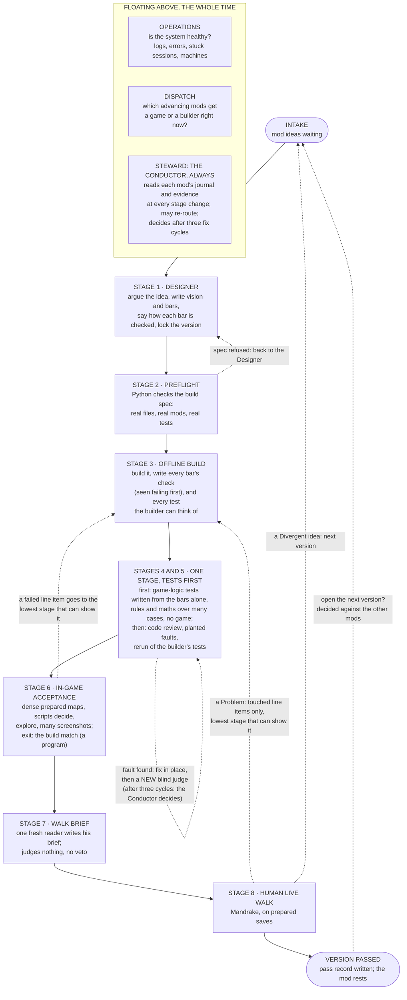

# The Maturation Pipeline

**Design Version 0.1.0 of the pipeline itself. DRAFT for Mandrake to argue with, 2026-11-13.**

- The operating doc `design/RimMandrake/maturation_pipeline.md` §9 lists what is built, as read from the code.
- The statement of what is built was corrected on 2026-11-15. The old statement said that only the stage record and the queue admission were built, "nothing else". By then these parts were built too:
  - Dispatch and its timer;
  - the offline-build, blind and in-game briefs and launchers;
  - both exit readers;
  - the status page.
- He answered the six questions that blocked the pilot on the evening of 2026-11-13 (by card, two of them typed). Those answers are written into this draft. §8 lists them as "Decided".
- On 2026-11-14 he agreed the lock rule (§4, Stage 1). On that day he also answered questions 8, 12 and 18 by card (§8).
- Everything else marked [PROPOSAL] is still not his.

Item: `RIMMANDRAKE_DESIGN_MATURATION_PIPELINE_WHOLE_MOD_IS_THE_UNIT`.
Live status page: `D:\ClaudeWork\rimmandrake\conductor\MATURATION_NOW.md` (where each mod stands today).

## How to read this

Every statement carries one of three marks.

| mark | meaning |
|---|---|
| **[HIS]** | Mandrake's own words, quoted and dated, or a thing he agreed to in words quoted here. |
| **[CARRIED]** | Already ruled by him earlier. The ruling is cited. Nothing new is decided. |
| **[PROPOSAL]** | An agent's suggestion. The suggestion is not his until he says so. Where the Conductor and this writer disagree, both views are given. |

In a table, the mark in a row's last column covers the whole row.

Words used here:

- **Mod**: one RimMandrake mod, for example Explosive Knockback.
- **Design Version**: the numbered design that a mod is built towards, for example 0.1.0. [CARRIED: his ruling of 2026-11-13, `design/RimMandrake/standing_rulings.md`, "Mod Design Versions use Semantic Versioning".]
- **Bar**: one thing that must be true for a version to pass. A bar is a plain sentence about what the player sees or can do. A bar is an acceptance criterion.
- **Check**: the code that decides a bar. In this spec a bar's "test" is its check.
- **Line item**: one bar together with the one test that decides it. A line item has an id, the files it reads, and a stored verdict. [CARRIED: `design/RimMandrake/validation_map_and_rules.md`, "Words used throughout".]
- **Blind judge**: a fresh agent that did not do the work and is not told what an earlier judge found.
- **Offline**: without a running game. **In-game**: through a running RimWorld.
- **The games**: ArchBig and ArchSmall on Archmagi (his machine), Steve1 and Steve2 on SteveDesktop (the second machine). `CLAUDE.md` §There are several live games.
  - SteveDesktop runs the test queue: scripted game tests, unattended, nobody watching.
  - **[HIS, by card 2026-11-14]** Any game may give the scripted verdict on an in-game bar. Dispatch takes whichever is free.
  - **[HIS, 2026-11-17]** SteveDesktop's queue takes any mod's token-free test, whatever its stage. (Both: §4 Stage 6, "Which game runs what"; §8, decision 18).
- **Evidence-for-Ask**: take the obvious answer, and pause for him only with concrete evidence against it. His five acts still wait for him. The home section gives the full rule. [CARRIED: his ruling of 2026-11-15, `design/RimMandrake/standing_rulings.md` §Evidence-for-Ask.]
- **RimFlow**: the ticket ledger. RimFlow stays. RimFlow is not the pipeline.

---

## 1. His words

**[HIS] 2026-11-13, afternoon (Pacific), typed to the Conductor. One message, verbatim.**

> Ok, I'm with you. Yes, we're going to do what you recommend. But we need to do much more too. This is becoming a new Pipeline, much better than Relentless Pipeline. And boy do I need a beautiful Markdown to see how its phases all relate to each other, which Mod is where in the process, etc. This isn't a ticket tracking system I'm describing, that's RimFlow, and it certainly isn't going to just "take the next ticket" and work it. It is a Maturation Pipeline with a work unit that's a whole versioned Mod. We need to show how many "new mod ideas" we have waiting to process (maybe zero at this time, maybe not, they're all trapped in tickets). Then there's the Designer whose job it is to talk with us until we create a well defined series of specifications and acceptance criteria to "some level" we will be tuning for quite awhile likely. Within the Designer are those 1-5 steps you showed me. That really should be more like a "Stage 1" of the pipeline. AFTER that should be a Stage 2 that's the "preflight" to judge the build specification that comes out of designer, real files, real mods, real acceptance tests, Pythonic. Then a Stage 3 that's offline Build/implement including all testing it can think to perform itself. Then a Stage 4 that's offline blind code review, mutation-type coverage challenges, and verification of test outputs/rerunning plus judgement. If it finds issues, it should FIX THEM RIGHT THERE and force the system to pass, but then send it back to just before Stage 4 again for a new blind judgement pass, and these cycles should be tracked on the work item so we can monitor a cycling ticket. Stage 5 should be Offline game logic testing in all its many forms [question, is this really different than Stage 4, or should it be folded in?], with the same "Once you make your list of what's wrong, you're the one who should fix it RIGHT NOW and show it working... then send it back to a new blind you to start again for judgement." Stage 6: In-game acceptance testing with setup maps, proper acceptance testing, and using the fastest methods available with dense, rich setups that test many items simultaneously + allowances to explore beyond the acceptance tests and plentiful screenshots to look for "strange unexpected things." Stage 7: Final pre-human check to examine all the evidence as not merely sufficient but consistent and not containing obvious anomalies beyond the stated goals that would waste a human's review time. Stage 8: Human live-walk of prepared sittings, savegames, maps, etc. The whole time, floating above: Operations monitoring the functioning of the system, the flow of items, logfiles, lack of errors, resources, no idle/stuck sessions or machines, etc. as before. Dispatch ensuring timely execution of processing and agents, closing of finished agents, as before. Except that dispatch isn't working "by the ticket" anymore. It instead knows which Mods we are currently advancing and is opportunistically allowing them access to the two live games or offline builders/fixers as they currently need as they move through the system. This... is my attempt to describe what I've been trying to do with you 1-on-1 this whole time. But I feel like every time we write this up and implement it, it loses so much intelligence. How can we preserve that extremely productive interaction I enjoy when I work with you tightly like I'm doing right now? When we spot things together? Should Conductor (or something like Conductor) be floating over the process more regularly, taking in the status of items, peeking in on live game runs or findings, remembering the "beyond this one moment" context to recognize problems, etc? I feel like that might be a piece of this as well. In a nutshell: does this Pipeline idea look good? Relentless pipeline is done, we're not going back to that idea. But we need a pipeline. This looks like a more "Artisan-inspired" Pipeline concept. What do you think?

**[HIS] Earlier in the same sitting, verbatim.**

> I had thought it would be useful to go through the Designer on each of these mods until we have a very well designed set of definitions (we should already be very close) and acceptance tests (that's what we need to produce).

> can't we actually simulate that settings check offline? That seems a gratuitous use of the game, unless that's actually a very fast check?

**What "what you recommend" refers to.** Just before his message the Conductor had recommended six things. His "Yes, we're going to do what you recommend" makes the six things **[HIS] by agreement**. The wording of each one is the Conductor's:

1. Lock the five mods now in the Designer as Design Version 0.1.0, as they stand.
2. Hold the scheduled Designer judge loop on those five.
3. Give every bar a test, tagged with the stage that proves it. (The lock rule of 2026-11-14 says what the lock requires of that test: §4 Stage 1.)
4. Fold his held look statements in as bars. (The statements are the 66 things he said during live looks on 2026-11-12 and 2026-11-13. The folder `design/RimMandrake/validation_holding/` keeps the statements.)
5. Keep the Designer for arguing ideas and edges.
6. Pilot on Explosive Knockback first.

His full message is also kept at `D:\ClaudeWork\rimmandrake\conductor\maturation_pipeline_20261113\OWNER_WORDS.md`.

**[HIS] 2026-11-15 (Sunday), typed to the Conductor, two messages minutes apart, verbatim (phone typos fixed). On the ledger at 12:42 and 12:46 PM PST, item `RIMMANDRAKE_HARDEN_PIPELINE_WHERE_HANDS_CLEANED_UP`.**

> Fix the process wherever it didn't work, ok? Make the pipeline better, don't keep cleaning up after it and leaving it alone

> Please make this a principle of the Maturation pipeline: the Pipeline fixes its own issues once detected. When there's a clear problem and a known fix... do it. It's not a ticket for someone else, it's a ticket to file then do yourself.

What these two messages mean in practice: §5, "The pipeline fixes its own defects".

---

## 2. The idea in eleven lines

1. **[HIS]** The pipeline moves **whole versioned mods**, not tickets. Tickets stay in RimFlow.
2. **[HIS]** Ideas wait at an intake. A mod then passes eight stages. The first five are Designer, preflight, offline build, offline blind challenge and offline game-logic testing. The last three are in-game acceptance, pre-human check and human live walk.
   - **[HIS, 2026-11-17]** The pre-human check judges nothing. One fresh reader reads once and writes his walk brief. The reader has no veto (§4 Stage 7).
   - **[HIS, by card 2026-11-13]** Stages 4 and 5 run as one stage, tests first (§8, decision 1).
3. **[HIS]** A judge that finds a fault at Stages 4 and 5 fixes it at once and shows it working. Then the judge hands the mod to a **new** blind judge. The cycles are counted on the mod.
   - **[HIS, 2026-11-13]** After three cycles the Conductor decides what to do. He confirms or changes the decision when he is next available (§8, decision 3).
4. **[HIS]** Operations and Dispatch float above. Dispatch knows which mods are advancing. Dispatch gives them the games and the offline builders as they need them.
   - **[HIS, by card 2026-11-14]** Either game may give a bar's scripted verdict, whichever is free (§8, decision 18).
   - **[HIS, 2026-11-17]** SteveDesktop takes any mod's token-free tests whatever its stage (§8, 18c).
5. **[CARRIED]** The target holds still: a mod is built towards a locked Design Version. A change that shifts the vision goes to the next version. (His ruling of 2026-11-13.)
6. **[CARRIED]** An objection sends back only the line items it touches, to the lowest stage that can show the fault. (Rule 2 of `validation_map_and_rules.md`, his card answer of 2026-11-12.)
7. **[PROPOSAL]** The mod is the unit that flows. The line item is the unit that is re-tested.
8. **[HIS, by card 2026-11-13]** The **steward** is the Conductor, always.
   - **[PROPOSAL]** Each mod has a **journal file**. The Conductor reads the evidence at every stage change. The journal holds the memory. This is the answer offered to "how do we preserve the intelligence".
9. **[HIS, 2026-11-13]** He may look at any stage. Questions may be sent to him at any time. The Conductor lets him know (§8, decision 5).
   - **[PROPOSAL]** An early look produces line items like any other.
10. **[HIS, by agreement]** The pipeline is done by hand on Explosive Knockback first.
    - **[PROPOSAL]** Only what proved boring by hand gets automated.
11. **[HIS, 2026-11-15]** The pipeline fixes its own defects once they are detected. A clear problem with a known fix is a ticket to file and then do in the same run. Such a ticket is not for someone else (§5, "The pipeline fixes its own defects"). A mod's gaps still go through the stages.

---

## 3. The map

Stage numbers are his. The dotted arrows are the roads back.



Plain-text version of the same map:

```
  FLOATING ABOVE, THE WHOLE TIME
  ┌──────────────────────┬─────────────────────────────┬──────────────────────────────────┐
  │ OPERATIONS           │ DISPATCH                    │ STEWARD: THE CONDUCTOR, ALWAYS   │
  │ is the system        │ which advancing mods get a  │ reads each mod's journal and     │
  │ healthy?             │ game or a builder now?      │ evidence at every stage change   │
  └──────────────────────┴─────────────────────────────┴──────────────────────────────────┘

  INTAKE ──▶ 1 DESIGNER ──▶ 2 PREFLIGHT ──▶ 3 OFFLINE BUILD ──▶ 4+5 ONE STAGE, TESTS FIRST
  (ideas      (vision,       (Python,        (code, every bar's  (first: game-logic tests from the
   waiting)    bars, how      no model)       check, its own      bars alone, many cases, no game;
               checked, lock)                 tests)              then: review, planted faults, reruns)
                  ▲               │                 ▲              │    ▲
                  └── refused ────┘                 │              └────┘
                                                    │           fix in place, NEW blind judge;
                                                    │           after three cycles the Conductor decides
                                                    │
  ──▶ 6 IN-GAME ACCEPTANCE ──▶ 7 WALK BRIEF ──────▶ 8 HUMAN LIVE WALK ──▶ VERSION PASSED
      (dense maps, scripts,     (one fresh read;      (Mandrake, on          (pass record;
       explore, screenshots;     judges nothing,       prepared saves)        the mod rests)
       exit: the build match)    no veto)
            │                                               │
            │                                               ├── a Problem ──▶ touched line items only,
            └── failed line item ───────────────────────────┘                to the LOWEST stage (3, 4+5
                goes to the lowest stage that can show it                    or 6) that can show it
                                                            └── a Divergent idea ──▶ next version ──▶ INTAKE
```

**[HIS]** the eight stages, their order, their numbers, the fix-in-place loop, Operations and Dispatch above.

**[HIS, by card 2026-11-13]** Stages 4 and 5 as one stage, tests first. The steward is the Conductor, always. After three cycles, the Conductor decides.

**[CARRIED]** the roads back from 6 and 8 (rule 2, "lowest stage, touched line items only"); the Divergent road (Design Versions ruling).

**[HIS, 2026-11-17]** Stage 7 has no road back. Stage 7 judges nothing. What the Stage 7 reader notices goes into the walk brief or onto a ticket.

**[PROPOSAL]** The numbers 6 to 8 stay unchanged after the merge. (This comes from the recommendation that he answered: one ordered stage, still reported as "Stage 4" and "Stage 5", so that his numbers 6 to 8 do not move. The card did not rule on numbering.) The road from "passed" back to intake is also a proposal.

---

## 4. The stages, one table each

"Model tier" points at `infrastructure/agents/Agent_Policy.md` (the file that says which model does which work). The ladder is not repeated here.

"Tracked on the mod" means: written into the mod's own version record. Then the status page can show the value and ask nobody.

### Intake: ideas waiting

| | | mark |
|---|---|---|
| Purpose | Hold mod ideas, and mods that exist but have no locked design, until one is chosen to advance. Show how many are waiting. | HIS ("We need to show how many 'new mod ideas' we have waiting to process") |
| Who | Nobody works here. No mod enters Stage 1 until one of the four advancing mods (Explosive Knockback, FlowWorks, Gimme Some Slack, Pyrelands) reaches his live walk (Stage 8). After that, mods enter by his order of 2026-11-15 (§8, decision 8) with no ask (Evidence-for-Ask). | HIS, by card 2026-11-14 ("Wait for one full pass"; §8, decision 8) |
| Model tier | None. A list, read by a program. | PROPOSAL |
| Inputs | Today: 42 "first touch" Designer items in RimFlow (`python3 src/RimMandrake/Utils/owner_queue.py`, measured 2026-11-13 3:03 PM PST). Other ideas sit inside tickets. Those ideas are not counted yet. | measured; "trapped in tickets" is HIS |
| Outputs | One line per waiting mod: its name, one sentence, whether code already exists. | PROPOSAL |
| Exit ("ready" means) | Intake is closed until one of the four reaches Stage 8. After that, mods enter by his order of 2026-11-15 with no ask (§8, decision 8). Before that, a mod leaves intake only on his words in the request (`advance --owner-said`): "If the current mod set isn't enough to keep the pipeline busy then pick the next most mature biome mod to add." (Contagion entered this way.) | HIS, by card 2026-11-14; HIS, 2026-11-15 ~05:40 PST |
| Road back | A mod can be put back at intake at any time. Nothing is lost: its folder stays. | PROPOSAL |
| Tracked on the mod | Date it arrived; date it was picked. | PROPOSAL |

### Stage 1: Designer

| | | mark |
|---|---|---|
| Purpose | "Talk with us until we create a well defined series of specifications and acceptance criteria", to a level that will be tuned over time. | HIS |
| Who | The Designer role (`src/RimMandrake/rimflow/roles/designer.md`), with him. The Designer's inner steps (Read, Argue the idea, Argue the edge, Write, Exam, Lock) live inside this stage. | HIS ("Within the Designer are those 1-5 steps... more like a 'Stage 1'") |
| Model tier | Judgment work: see Agent_Policy.md, "The one question". | CARRIED |
| Inputs | The idea. His words. If any code exists: a live walk of what exists, before more design is added. | CARRIED (his ruling 2026-11-12 5:06 PM PST, rule 7 of `validation_map_and_rules.md`) |
| Outputs | The mod's version folder: a short vision, the bars, and for every bar **how it will be checked (offline, or an in-game scene), with the stage that proves it**. Also the next-version file and the Polish list. | HIS by agreement (recommendation 3; the lock rule 2026-11-14); folder layout CARRIED from the Design Versions ruling |
| Exit ("ready" means) | He said "lock it" for this version. Or, for a new mod's 0.1.0 with no evidence against it, the pipeline locked it (Evidence-for-Ask, 2026-11-15). Every bar is written. Every bar names how it will be checked and its stage. No check code is required. | CARRIED (Design Versions: locked on his word); the rest HIS by agreement (the lock rule, below) |
| Road back | When Stage 2 refuses the spec, the mod comes back here for the refused lines only. After the lock, a Divergent idea never comes back here in this version. The Divergent idea opens the next version. | CARRIED (rule 2; Design Versions ruling) |
| Tracked on the mod | Version number; state (drafting, locked); count of bars; tokens spent; his open questions. | CARRIED (Design Versions draft §3.7) |

#### The lock rule

**[HIS, by agreement 2026-11-14, about 12:50 PM PST]** The Conductor proposed this rule. He answered "Yes this all sounds good." (recorded on `RIMMANDRAKE_DESIGN_MATURATION_PIPELINE_WHOLE_MOD_IS_THE_UNIT`). His own words on the rule:

> Acceptance tests evolve just like implementation and design evolve based on discoveries as we go. So we need to acknowledge that a lock is never as strict as we'd like. But I understand the stricter the better.

> If it doesn't have good acceptance tests we need a way to get them. Designer is the only way I know how to do that... this is why most of our built mods still need that pass even if they're built.

1. **Bars and checks.** A bar is a plain sentence about what the player sees or can do. A check is the code that decides the bar. Bars come from the Designer pass, and every built mod still needs that pass. Checks are builder work.
2. **At the lock**, every bar is written. Each bar names how it will be checked: offline, or an in-game scene. No check code is required at the lock. For each check Stage 2 reads:
   - its id;
   - its stage;
   - the file it will live in;
   - what it will observe;
   - the files it reads.
3. **Right after the lock (Stage 3)**, a builder writes every check. Each check is seen failing where the behaviour is missing. A mod does not move past Stage 3 until every bar has a check that runs. The builder runs each in-game scene that its change touches on a free game, in the same run. A scene that no free game could take may be recorded UNRUN, with its command, until a live run of it.
4. **A lock means changes are visible and have a reason, not that nothing changes.**
   - The check was wrong and the bar's meaning is unchanged: the steward (the Conductor) fixes the check and re-pins it. One journal line says why. He is not asked.
   - A bar is added because of a discovery: agents may do it, recorded in the journal.
   - A bar is made easier or deleted outright: this is a recorded act of the Conductor window (his ruling of 2026-11-19, the five acts), with `lost:` and `undo:` in its why. The act names the discovery that made the bar wrong. The act goes into his daily digest.
   - A bar is deferred (put off to a later stage or to the next Design Version). The Conductor decides and tells him after.
     - **[HIS, 2026-11-14, about 1:05 PM PST]** "Let's try you deferring and letting me know. If it happens too often then we will change it." This is a trial he may withdraw. Each deferral is one journal line in the intervention form (§5 item 5). So the Maturation Now page counts deferrals per mod, and "too often" can be seen.
   - A discovery that changes what the mod is: the change is not a bar edit. The change goes to the next Design Version.
5. **Every one of these is one journal line** in the intervention form. §5 ("The steward and the journal", item 5) gives the form. So the Maturation Now page shows it as a yellow arrow on that mod's stage box. A lock reopened again and again is the visible sign that the design was not ready.
6. **The four locks of 2026-11-13** (Explosive Knockback, FlowWorks, Gimme Some Slack, Pyrelands) were valid under this rule, not early. Their missing checks are Stage 3 work.

One proposal inside Stage 1 is big enough to be an open question. The question is whether the Designer's Exam and coverage judge stay as gates (open question 7).

### Stage 2: Preflight

| | | mark |
|---|---|---|
| Purpose | "Judge the build specification that comes out of designer, real files, real mods, real acceptance tests, Pythonic." Stop a spec that cannot be built or tested before a token is spent on building it. | HIS |
| Who | A Python program. No model. | CARRIED (his ruling 2026-11-12 3:18 PM PST: "Before a single token is spent, a deterministic python script should confirm everything it can") |
| Model tier | None. | CARRIED |
| Inputs | The locked version folder; the repo; the list of every def in the game; the mod lists. | CARRIED (spec `design/specs/2026-11-12-ticket-preflight-before-any-token.md`) |
| Outputs | A preflight record: each check, pass or refuse, the smallest fix for each refusal, and how long the run took. | CARRIED (same spec; "the precise time this took to run" is his) |
| Exit ("ready" means) | Every named file, def and mod is real. Every bar names its check. Every check names its stage. A check whose code is not written yet is not a refusal. Writing that code is Stage 3 work (the lock rule). Every test that needs the game says why an offline test cannot decide it. Every test that needs the full mod list says why. Every kind B or C tag carries `tag_evidence`, and a kind B tag carries its `budget` (`tests.<id>.test_kind`; `roles/designer_scene_contract.md` §The kind of a scene). Every held look statement for this mod (`design/RimMandrake/validation_holding/`) has been placed in the mod's table. That placement is the ingest. | First two CARRIED; "every bar has a test" HIS by agreement; "says why the game is needed" PROPOSAL (agreed by the Conductor and this writer; see "On 'the cheapest stage that can decide it'" after this table); full-list reason CARRIED (his 2026-11-12 ruling); held statements HIS, by card 2026-11-14 ("Per mod, as it advances"; §8, decision 12) |
| Road back | A refusal names the line and the fix. A wrong fact goes back to Stage 1. A broken criterion goes to the neutral fixer (a fresh agent that repairs acceptance criteria and is neither the judge nor the builder). | CARRIED (his refusal ruling 2026-11-12 2:50 PM PST) |
| Tracked on the mod | Last preflight time and duration; refusals open. | PROPOSAL |

**On "the cheapest stage that can decide it".** **[PROPOSAL]** The Conductor proposes that preflight checks this mechanically. This writer agrees in part.

- Python can check that a stage is *declared* and that a game-stage test carries a *written reason*.
- Python cannot check that the reason is *true*. That part is judgment. That part belongs to the Stage 4 challenger.
- The challenger is asked one extra question per game-stage test: "could a faster test decide this?"
- His settings question of 2026-11-13 ("can't we actually simulate that settings check offline?") is exactly that question.

### Stage 3: Offline build

| | | mark |
|---|---|---|
| Purpose | "Offline Build/implement including all testing it can think to perform itself." | HIS |
| Who | Builder agents, one RimFlow ticket at a time, inside this mod. | HIS (tickets stay in RimFlow); PROPOSAL (tickets are the work inside the mod's current stage) |
| Model tier | Per ticket: see Agent_Policy.md, "The ladder" and "Helpers in this repo". | CARRIED |
| Inputs | The locked version; the preflight record. | PROPOSAL |
| Outputs | Code, defs, art. For each bar, its offline test and its in-game test. Each test was watched failing before the code made it pass. Review status clean. | CARRIED (his ruling 2026-11-13: "we build the test at the same time as the item, both offline and online versions") |
| Exit ("ready" means) | Every bar has a check that runs, each seen failing where the behaviour was missing. Every bar's offline check passes. Every in-game check exists with its exact command. Each one that the build touched was run on a free game in the same run (`maturation.py live-row`; Stage 6 counts that run as a row of its next visit), or is listed UNRUN with its exact command because no game could take it. **[HIS, 2026-11-24]** ("Was a game available? Because it so, that builder should have deployed it and tested it right away in the same context.") The builder's own list of what it could not test is written down. | HIS by agreement (the lock rule, §4 Stage 1); "passes" and the builder's list PROPOSAL |
| Road back | None of its own. Faults found later arrive here as line items. | CARRIED (rule 2) |
| Tracked on the mod | Tickets open and done in this stage; bars with a passing offline test, of total; tokens. | PROPOSAL |

**[PROPOSAL]** For a mod that is already built (the five mods of 2026-11-13: Explosive Knockback, FlowWorks, Gimme Some Slack, Pyrelands and Graffiti), Stage 3 is not "build". Stage 3 is then "reconcile". Check each locked bar against what exists. Build only the missing tests and the missing pieces.

**[HIS, 2026-11-17]** From a mod's first build, the builder's brief carries the offline model. The road-back fixer's brief carries it too. The offline model is:

- decision logic that is Verse-free (no Verse types), so that an offline test runs the shipped decision;
- a generator of the mod's situations, read by the bars' own checks before any fix or tuning;
- the range of the generator, declared.

The one source is the offline-model block of `roles/builder.md`. The ruling is `design/RimMandrake/standing_rulings.md` §Every mod builder builds the offline model from the first build.

### Stages 4 and 5: Blind offline challenge and game-logic testing, one stage, tests first

**[HIS, by card 2026-11-13]** "One stage, tests first." His question "is this really different than Stage 4, or should it be folded in?" is answered: one stage.

- Order keeps the independence that two stages would have bought. First the blind agent writes and runs its own game-logic tests from the bars alone. The agent does this before it opens the builder's code or tests. Only then does the agent do the code challenge.
- The result is one load of the mod, one cycle, and independent tests.
- The two parts are reported as two lanes, so the pilot can count what each lane finds.
- **[PROPOSAL]** The stage keeps the label "Stages 4 and 5", so that his numbers 6 to 8 do not move.

| | | mark |
|---|---|---|
| Purpose | Stage 4: "Offline blind code review, mutation-type coverage challenges, and verification of test outputs/rerunning plus judgement." Stage 5: "Offline game logic testing in all its many forms." In plain words, the stage asks four questions. Are the mod's rules and maths right over thousands of cases without the game? Does the code do what it claims? Can the tests actually fail? Do the builder's test results repeat? | HIS |
| Who | A fresh agent that did not build the mod and is not told what any earlier judge found. | HIS ("a new blind judgement pass"; "send it back to a new blind you") |
| Model tier | A judging role: see Agent_Policy.md, "Four places a cheaper tier is forbidden outright". | CARRIED |
| Order | First, take only the locked bars, the code's logic kernels (the game-free core of a mod's rules) and the mod's settings as shipped. Write the game-logic tests and run them. Then open the code, the builder's tests and their recorded outputs for the review, planted faults and reruns. | HIS, by card ("tests first"); the exact inputs per part PROPOSAL |
| Outputs | Lane 1 (game logic): test rows; random cases with the failing case shrunk to its smallest form; conservation checks (nothing created or lost); the shipped settings swept through their ranges. Lane 2 (challenge): a list of faults, each as detailed as the evidence; planted-fault results; rerun results. Each fault says what would pass and names the smallest fix. A planted fault is a deliberate bug put in to see whether a test catches it. | Lane 1 CARRIED (kept schemes, his picks of 2026-11-12, listed in §7 "The kept validation schemes": kernels with random cases, shipped-settings sweep with conservation laws); lane 2 HIS for the content, record shape CARRIED (refusal ruling 2026-11-12) |
| Exit ("ready" means) | Every bar tagged "offline" is green. A blind judge found nothing that is a Problem. | PROPOSAL (Problem versus Polish is CARRIED from his card of 2026-11-13); **built as the rule 2026-11-18**: `advance` refuses a forward move whose program exit reading is not met. A steward's word alone moves nothing. The only override is his OWNER event newer than the cycle or visit (clause `exit_met`; delegated Evidence-for-Ask decision of 2026-11-15, RIMMANDRAKE_BIND_ADVANCE_TO_EXIT_READINGS). **On a game-only move** (`advance --to in_game --game-only <IDs>` whose `game_only` clause passes), the exit does not count two things. The exit does not count the new blind judge owed only for the cycle's own FIXED Problems, each shown red then green. The exit does not count a lane-1 `not_kernel` UNSETTLED row when a named game-only item carries each of its bars (the item's title names the bar). An unfixed Problem, any other gap, and every other move still refuse (the Conductor's act of 2026-11-19, RIMMANDRAKE_UNBLOCK_GAME_ONLY_ADVANCE_AT_BLIND_EXIT; page `design/specs/2026-11-19-maturation-game-only-blind-exit/boundary.md`) |
| Road back | "If it finds issues, it should FIX THEM RIGHT THERE and force the system to pass, but then send it back to just before Stage 4 again for a new blind judgement pass." "Once you make your list of what's wrong, you're the one who should fix it RIGHT NOW and show it working... then send it back to a new blind you." Since 2026-11-20 a fixed mod owes ONE fresh reader of each fix, not a whole new blind cycle. The fresh reader is a run that did not make the fix. The fresh reader reads only that fix, once (`read_exit`, `fix_reader_owed`). A wrong check or scene that the judge repairs, seen FAIL on a planted fault and PASS on the real build, owes nothing more (`check_repairs`). | HIS; HIS 2026-11-20 for the fresh reader and the wrong check (standing_rulings §Touching code has a cost) |
| What the next blind judge reads | **"All once, then changes."** The first judge reads everything. After a fix, the new judge reads the changed files and the line items whose inputs changed. The new judge is not told what the last judge found. A fault found late in unchanged material is still fixed, and is logged as a miss of the first judge. | HIS, by card 2026-11-13 |
| Tracked on the mod | "These cycles should be tracked on the work item so we can monitor a cycling ticket": the cycle count; per cycle, what each lane found, what was fixed, which tests were edited, tokens; lane 1 rows passing of total. | HIS for the count; detail PROPOSAL |

**Guards on fix-in-place.** **[PROPOSAL]** from the Conductor; this writer agrees and adds the last one.

- The fixer may not edit a bar or an acceptance criterion. A wrong criterion goes to the neutral fixer. (This part is [CARRIED], his refusal ruling.)
  - [HIS by agreement] The steward re-pins a wrong check whose bar keeps its meaning. A bar changes only as the lock rule allows (§4 Stage 1).
- Every test the fixer edits is listed in the cycle record and shown to the next blind judge. Otherwise "force the system to pass" could be done by weakening a test.
- Added by this writer: each fix is shown red first. The fixer records the test failing on the old code, then passing on the new. "Show it working" is his phrase. Red-first is how it is shown.

**After three cycles.** **[HIS, 2026-11-13, typed]**

- "After three cycles, Conductor is brought in (Fable 5.2 class reasoner) to make a decision on what to do. When the user is next available, they are informed and the decision is confirmed or changes made. Conductor may choose any of the options you offered, or yet more creative ones (it may see how to fix the problem in a way the judges did not)."
- The options offered were: defer a bar, repair a criterion, call it a design fault, or allow one more cycle.
- Cycles are counted on the mod. A fourth judge never starts on its own.

### Stage 6: In-game acceptance

| | | mark |
|---|---|---|
| Purpose | "In-game acceptance testing with setup maps, proper acceptance testing, and using the fastest methods available with dense, rich setups that test many items simultaneously + allowances to explore beyond the acceptance tests and plentiful screenshots to look for 'strange unexpected things.'" | HIS |
| Who | A live-test agent driving one of the games. Scripts give the verdict on each bar. The agent explores and looks. | HIS for the stage; "scripts decide" CARRIED from stage 4 of the earlier stage map (§7; not his by card) |
| Model tier | A live driver: see Agent_Policy.md, "Helpers in this repo". | CARRIED |
| Inputs | The mod as deployed to the game; the in-game tests from Stage 3; a prepared map built by the mod's own proof script. | CARRIED (rule 5: dense, labelled savegame on matrix scenes, his words of 2026-11-12) |
| Outputs | One verdict per in-game line item. No run stages a raid: a raid scene reads PAUSED, holds no exit, and leaves its bar open until the version's pass (standing_rulings.md §The cheapest test that decides the bar). Each scene declares its kind (A, B or C), and each run ends in one of seven outcomes (standing_rulings §Live tests have three kinds). Screenshots. A list of strange things seen that no bar covers. A labelled savegame. | HIS |
| Exit ("ready" means) | Every in-game line item has a passing verdict that still stands, on a site that was checked first (open sky, no stray animals). The verdicts come from any visit: no exit asks for every scene in one visit, or for one scene several times in a row. A kind B scene passes as §Live tests have three kinds says. A kind C hunt is never part of the exit. Every strange thing is either explained or filed. The savegame for him exists. | CARRIED (rule 6: "a site is asserted, never hoped", his words 2026-11-12) plus PROPOSAL; **built as the rule 2026-11-18**: `advance` refuses a forward move whose program exit reading is not met. A steward's word alone moves nothing. The only override is his OWNER event newer than the cycle or visit (clause `exit_met`; delegated Evidence-for-Ask decision of 2026-11-15, RIMMANDRAKE_BIND_ADVANCE_TO_EXIT_READINGS) |
| Road back | Each failed or unmeasured line is classed first: the mod is wrong, the check is wrong, or the staged scene is wrong. A run that its environment spoiled is an ENVIRONMENT FAULT. It is none of the three, and it needs no later pass to cancel it (standing_rulings §Live tests have three kinds). A wrong check or scene never goes back. The driver repairs it in the sitting. The repaired check or scene counts only when it is seen FAIL on a planted fault and PASS on the real build. When no bar needs the check or scene, it is removed from the test table, with one polish line as the record. A mod fault that the driver can fix is fixed in the sitting (a before/after test, the checks that the fix touches re-run on the fixed build, one fresh reader of the fix). Only two things go to the lowest stage that can show the fault: a mod fault that could not be fixed there, and a bar left undecided. For those lines an offline test that fails on the old code is written first. The driver files those lines itself before it ends. Only that line item and those sharing its inputs are re-run. | CARRIED (rules 2c and 2d); HIS 2026-11-20 for the classes, the fix in the sitting and the removal (standing_rulings §Touching code has a cost) |
| Tracked on the mod | Rows pass, fail and unmeasured; which game; wall time; strange things open. | PROPOSAL |

The fastest methods:

- The 13-mod minimal list loads in 22 seconds. No test uses the full list. **[HIS, 2026-11-24]** (standing_rulings §Mod development runs on small lists)
- A flyer's flight is never tested live without him. **[CARRIED]**

#### Which game runs what

**[HIS, by card 2026-11-14]** (§8, decision 18.) "Whichever game is free". **[HIS, 2026-11-17]** SteveDesktop's entry rule is open (18c).

| work | game | mark |
|---|---|---|
| The scripted verdict on each locked in-game bar | Either game: Dispatch takes whichever is free | HIS, by card 2026-11-14 (18a) |
| Exploring beyond the bars; screenshots looking for strange things | ArchBig or ArchSmall | PROPOSAL: an agent must look, and the looking tools run there |
| The labelled savegame and his live walk (Stage 8) | ArchBig or ArchSmall, on the mod's small list: the game whose Saves folder holds the savegame | HIS, 2026-11-24 ("go") |
| Re-running a passed version's bars when something it depends on changes | Either game, through the queue (§6, "After a version passes") | HIS, by card 2026-11-14 (18b): built only after one version has passed |

**A verdict counts only on the version and list he walks.** This rule follows from 18a. A pass from a game that ran a different build proves nothing about the build that he walks.

**[HIS, 2026-11-17]** ("I approve your changes to the Step 6->Step 7 transition and preparation", item `RIMMANDRAKE_FOLD_STAGE_SEVEN_INTO_WALK_BRIEF_NO_VETO`.)

- The **build match** is a program, no model. The build match runs at the Stage 6 exit.
- **What a row records.** Every in-game verdict row records five things:
  - the game it ran on;
  - the mod's source sha;
  - a hash of the mod's deployed folder there;
  - the active mod list, read by parsing that game's `ModsConfig.xml` (`activeMods`, in order);
  - the game build.
- **Where the runner gets them.** The runner runs `python3 src/RimMandrake/rimflow/build_match.py identity --mod <Mod> (--tier <T> | --full)` after the deploy and the list swap. The runner merges that line into every row.
- **What the program compares.** The program reads the same things, on the Archmagi game that holds the walk savegame, for the build that he walks:
  - the mod's deployed folder hash;
  - the game's `Version.txt`;
  - the mod list of the labelled walk savegame that the Stage 6 Exit block names.
- **Which row.** The program compares each check's last row with those readings. The last row is the row of visit N. If visit N has no row, the last row is the row of the latest earlier visit.
- **A different game build.** A row whose game build differs does not count, and its line item is re-run.
- **A different mod hash. [HIS, 2026-11-21]** A row whose mod hash differs can still count. The row counts when the change since its commit touches nothing that its check reads or exercises (`src/RimMandrake/rimflow/rerun_relation.py`; `design/RimMandrake/standing_rulings.md` §After a change, only the checks that the change touches run again). Only a touched check, or a check whose relation cannot be read, is re-run. A walk folder that is not the current source is one act, a deploy. That act reruns no check.
- **The mod list.** The program compares the mod list as the test declares it. Full-list testing is retired (HIS, 2026-11-24).
  - A minimal-list test (the carried default, §4 Stage 6) must match the list of its tier. `modset_builder.py` builds that list from the same commit. The walk savegame's list is the mod's small list
    (`src/RimMandrake/Utils/small_list.py`).
- **How to run it.** `maturation.py` runs the build match in its Stage 6 exit reading (its `build_match` clause). `python3 src/RimMandrake/rimflow/build_match.py check --mod <Mod> [--visit N]` runs the build match alone. That command exits 0 only when every check counts.
- **Selftest:** `src/RimMandrake/rimflow/selftest_build_match.py` (with `--mutants`).

**Entry rule. [HIS, 2026-11-17, about 11:00 AM PST]** "Drop 11-14 limits, old rule. Clear its limitations. We are remeasuring it for a brand new pipeline." (item `RIMMANDRAKE_DROP_STEVEDESKTOP_PIPELINE_ONLY_LIMIT`.)

- Any mod's token-free test, proof chain, `--full` sweep or `--item` selection may be queued and filled on SteveDesktop. The mod's pipeline stage does not matter.
- `src/RimMandrake/Utils/testq/pipeline_admit.py` is the gate. `testq.py submit` calls it before anything else. The filler, the nightly sweep and the fault-window rerun call it too.
- The gate refuses one thing: a mod on his hold (`src/RimMandrake/rimflow/mod_owner_hold.json`, his 2026-11-16 hold). While that list cannot be read, the gate refuses every test.
- The filler (`coverage.fill_mods`) leaves held mods out.
- Ops jobs are never refused: the brake-release canary (`Operations.canary`) and the steward's repair wake (`BENCH.steward-wake`).
- The machine-safety brakes (fault monitor, hardware outage, brake release) are unchanged.
- Stage-6 `testq` blocks (`testq_blocks.py`) still name the modcheck chain of each check. So the filler walks a past-blind mod (a mod past the blind challenge) without hand wiring.
- Selftest: `src/RimMandrake/Utils/testq/selftest_testq_pipeline_admit.py` (with `--mutants`).

### Stage 7: Pre-human check, the walk brief

**[HIS, 2026-11-17]** Stage 7 judges nothing. He asked "What is step 7 in the maturation pipeline other than redundancy with just-passed judges?" and approved the change. The judges have judged. The build match (Stage 6) has kept only the verdicts that count on the build he walks. What is left is one fresh read that prepares his walk.

| | | mark |
|---|---|---|
| Purpose | Prepare his walk: one fresh read of the evidence "as not merely sufficient but consistent and not containing obvious anomalies beyond the stated goals that would waste a human's review time". What the read finds goes into his brief or onto a ticket. The read refuses nothing. | HIS (the quote); HIS, 2026-11-17 (no veto) |
| Who | ONE fresh reader that made none of the evidence writes: no stage move of this version and no in-game row. `maturation.py` refuses a brief whose `written_by` names a unit that made either. | HIS, 2026-11-17; CARRIED (user-level rule, 2026-10-22: "Read it first and see if it's obviously broken... before wasting a human's time") |
| Model tier | A reading role, one run. | PROPOSAL |
| Inputs | Everything from stages 2 to 6: records, test rows, screenshots, the savegame, the build match's reading, the journal and the commits since his last look, the mod's open tickets. | PROPOSAL |
| Outputs | The walk brief, `design/concepts/<Mod>/version/walk_brief/arrival_<N>.md` (N = arrivals at this stage), under four headings: what to open; what changed since his last look; "known, not fixed: you need not report these"; what it noticed first. Role: `src/RimMandrake/rimflow/roles/walk_brief.md`. | HIS, 2026-11-17; CARRIED (rule 4) |
| Exit ("ready" means) | The brief is written, its four headings filled, by a fresh reader. The reader has NO veto: a finding goes into the brief or onto a ticket, never down a road. No `--steward-confirms`. | HIS, 2026-11-17 |
| Road back | None. | HIS, 2026-11-17 |
| Tracked on the mod | Arrivals at this stage (`pre_human_arrivals`). Each arrival is one release candidate: 0.1.0-rc.1, 0.1.0-rc.2. Version numbering is unchanged. | CARRIED ("A judge round is a release candidate") with a PROPOSAL about what counts as a round (open question); HIS, 2026-11-17: the rc count per arrival stays |

### Stage 8: Human live walk

| | | mark |
|---|---|---|
| Purpose | "Human live-walk of prepared sittings, savegames, maps, etc." | HIS |
| Who | Mandrake. | HIS |
| Model tier | None. An agent may sit with him to stage and record. | PROPOSAL |
| Inputs | The Stage 7 brief; a dense, labelled savegame. For a mod that adds or changes creatures, the savegame holds one pen for each creature kind of the mod, with six animals in each (`src/RimMandrake/Utils/modcheck/walk_pens.py`), and the brief names where the pens are. | CARRIED (rule 5); HIS, 2026-11-24 (the pens) |
| Outputs | His words, verbatim, in the ledger. Each thing he says becomes one line item with a class: mod fault, test-map fault, test-tool fault, art, new bar, or question. Each pass he gives is pinned. | CARRIED (rules 2a and 2e) |
| Exit ("ready" means) | He passes the version. The pass record is written: date, git commit, bars, evidence, cost, cycles. | CARRIED (Design Versions draft §3.7); the pass is his alone |
| Road back | A Problem (a defect, or something a player would reject as strange or disappointing) stays in this version. The Problem goes to the lowest stage that can show it. Polish goes to the mod's Polish list; the Conductor decides each move and tells him after (card 2026-11-23). A Divergent idea goes to the next version. His objection closes only on his own later look, as a labelled cell in the next save he opens anyway. | CARRIED (his cards of 2026-11-13 and 2026-11-12) |
| Tracked on the mod | His minutes; objections by class; pinned passes; the pass record. | PROPOSAL |

---

## 5. Floating above

### Operations

**[HIS]** "Operations monitoring the functioning of the system, the flow of items, logfiles, lack of errors, resources, no idle/stuck sessions or machines, etc. as before."

Nothing changes in what Operations watches.

- **[PROPOSAL]** Operations watches one more thing: a mod whose stage has not moved for longer than that stage's usual time. Such a mod is "stuck". Operations reports a stuck mod the same way as a stuck session.
- **[HIS, 2026-11-14 ~9 PM PST]** (the same words as under Dispatch) This watch is built for the offline build. The reading is ops_watch's `maturation.idle_owed_max_min`. Its one fixed alarm is `OPS_MATURATION_IDLE_ADVANCING_MOD`. The alarm fires for an advancing mod at an offline stage, with work owed. Nothing has run on the mod for over 60 minutes.

### Dispatch

**[HIS]** "Dispatch ensuring timely execution of processing and agents, closing of finished agents, as before. Except that dispatch isn't working 'by the ticket' anymore. It instead knows which Mods we are currently advancing and is opportunistically allowing them access to the two live games or offline builders/fixers as they currently need as they move through the system."

**[PROPOSAL]** What replaces "take the next ticket":

- Dispatch holds a short list of **advancing mods**. Everything else waits at intake or rests.
  - **[HIS, by card 2026-11-14]** The list is the four (Explosive Knockback, FlowWorks, Gimme Some Slack, Pyrelands). Dispatch adds no mod to the list until one of the four reaches Stage 8 (§8, decision 8).
  - **[HIS, 2026-11-14 ~9 PM PST]** Graffiti joined the list by his word that night. (Graffiti stands at the Designer, which Dispatch never launches.)
  - **[HIS, 2026-11-15 ~05:40 PST]** Contagion joined the list by his order (§8, decision 8).
  - The shipped list is `advancing` in `src/RimMandrake/rimflow/maturation_dispatch.json`. The tick adds each concept that the Designer works. `./pipe queue` can change the list.
  - A mod can be on his hold (`src/RimMandrake/rimflow/mod_owner_hold.json`). The tick launches nothing on a held mod. A design-only pass (`designer_cleanse.py`) may run on the mod when its hold row allows that. A run that is already live finishes.
- For each advancing mod, Dispatch asks one question: what does this mod's current stage need right now? The answer is a game, an offline builder, a blind judge, or him.
- The games are the narrow point. A mod at Stage 6 waits for a game. A mod at Stage 8 waits for him and for the game on his machine. Offline stages never wait for a game.
- **[HIS, by card 2026-11-14]** (§8, decision 18) Dispatch sends a Stage 6 mod's scripted bar verdicts to whichever game is free.
  - Stage 8 is on Archmagi, ArchBig or ArchSmall [HIS, 2026-11-24].
  - SteveDesktop's queue admits any mod's token-free test, whatever its stage ([HIS, 2026-11-17], 18c).
- Inside a stage, the work is still tickets in RimFlow. The stage's worker picks among that mod's tickets. Nobody picks among all tickets of all mods.
- **[HIS, 2026-11-14 ~9 PM PST]** "So can we wire up Operations/Dispatch such that they do advance on these offline builders? This was pretty inefficient and pointlessly it seems, if I'm reading correctly. As long as we don't have automated loops rejecting/cycling things, we can't get into too much trouble." (That evening all four advancing mods had sat at Stage 3 for 6 to 9 hours with no builder on them. Every launch was a Conductor hand step.) So Dispatch launches offline builders by itself:
  - **The program.** `src/RimMandrake/rimflow/maturation_dispatch.py` runs on `rm-maturation-dispatch.timer`, every 60 seconds. The program makes the launch decisions, and it uses no model of its own. The status page has its own timer, `rm-maturation-page.timer`. The program does not yet judge a run that ended under 180 s ago. The shipped values of the numbers below are in `maturation_dispatch.json` beside the program. `./pipe` can change a limit or the model for one mod. `release` lets one launch past the ceiling.
  - **Which mod gets a builder.** The mod is an advancing mod at Stage 3. Its exit tests refuse bars as build work. No detached run is live on it. The program launches one capped builder on that mod (opus, USD 15, `maturation.py launch`).
  - **Guard rails, his condition.**
    - One builder is live on a mod at a time. At most `max_live` runs are live on advancing mods at once. (Two on 2026-11-14. His later words and cards moved the number. The Conductor moved it too. The file holds each change with its source.)
    - After a run ends, the next run starts only if the count of refused bars fell. Otherwise the program stops on that mod with a "Needs Conductor" line. The program never tries the same refusals again.
    - The program stops in the same way past `stage_ceiling_usd` spent at the stage. (USD 60 at first; 100 since his card of 2026-11-15.)
    - The program never judges, rejects, sends a mod back or advances it. The program launches nothing at any other stage but the blind challenge and in-game acceptance. The Designer stays his.
  - **At the blind challenge**, the program launches one capped judge when the cycle is owed. Nothing may be live or recorded on the cycle. (Item RIMMANDRAKE_BUILD_BLIND_CHALLENGE_LAUNCHER_FOUR_MODS_PARKED, 2026-11-15.) One visit gets at most `blind_auto_cycles_per_visit` automatic cycles. (One at first; three since 2026-11-15, his own limit.) The steward still confirms the exit, through a steward run. (See "Who does the Conductor's hand steps now" in this list.) When that run cannot resolve the cycle, the cycle is a "Needs Conductor" line.
  - **At in-game acceptance**, the program launches one capped live driver per visit. (Item RIMMANDRAKE_BUILD_IN_GAME_STAGE_LAUNCHER_PYRELANDS_ARRIVED_FIRST, 2026-11-15.) Three things must be true: the visit is owed, nothing is live on the mod, and a game is free. A free game has no live in-game run on it (one live-game driver per game). For a free game, `rimflow bridge idle` says that the bridge is takeable. The launcher shipped off (`ingame_enabled` false in `maturation_dispatch.json`) until the Conductor had run the first visit by hand. The launcher is on since 2026-11-15. A steward run also reads an ended visit that has an exit block. A visit with no exit block, or one that the run cannot resolve, is a "Needs Conductor" line.
  - **A mod whose exit tests all pass** reads "ready to advance".
  - **Who does the Conductor's hand steps now.** The same tick runs `src/RimMandrake/rimflow/maturation_autonomy.py`. That layer launches one capped steward run for each hand step. Three examples of a hand step follow. Confirm an exit. Send a failed line back as a named item. Advance a mod whose exit tests all pass. Other steward runs do the preflight step (Stage 2) and the walk-brief step (Stage 7), or read a stalled builder. A road-back item is an open item behind a failed line or a walk finding. A steward run, the judge or driver, or his walk names it. The tick gives each such item one fixer run. A pilot mod (`modledger.json` `pilot_mods`) first gets one run that works all of its open road-back items (a holder run). An item that only the game can show gets no fixer run at an offline stage (it goes to Stage 6, or on a pilot mod to a free game). His words of 2026-11-15 are the reason ("The steward and the journal", later in this section).
  - Graffiti joined the advancing list by his word the same night.
- Work that belongs to no mod (tools, infrastructure) stays ticket work in the one list, RimFlow. The List Pipeline works that list (question 14, "Tickets that belong to no mod"). A tool ticket that blocks an advancing mod takes that mod's urgency.

### The pipeline fixes its own defects

**[HIS, 2026-11-15]** "the Pipeline fixes its own issues once detected. When there's a clear problem and a known fix... do it. It's not a ticket for someone else, it's a ticket to file then do yourself." (Both messages in §1.)

What that means, for every agent and program in the pipeline (the tick, the steward, a judge, a fixer, a builder, a Conductor helper):

- The agent or program finds a defect in the **pipeline itself** (its code, tools, records, tests, status page). When the defect has a clear cause and a known fix, the finder does four things in the same run:
  - it files the ticket with its acceptance test;
  - it does the fix (tests first);
  - it publishes;
  - it says so in its report.
- A program does a deterministic fix itself and logs the fix. When the fix needs a model, the program files the ticket. The program then launches a fixer on that ticket itself, inside its live and spend caps. Nothing waits for a hand.
- The agent or program hands off only in one of these cases. The ticket then carries the evidence and what was tried.
  - The fix is not known.
  - The fix is outside its tools. (The fix needs the game and the agent holds no bridge, or the fix needs him under `delegation_policy.md` §2.)
  - The fix would change a north-star bar.
- A workaround by hand without the permanent fix is not allowed.
- Scope: the pipeline's own machinery. A mod's gaps keep going through the stages as designed.

Full text: `design/RimMandrake/standing_rulings.md` §"The pipeline fixes its own defects". The prose of this item says which "Needs Conductor" lines the tick still raises. The prose also says which of them the tick now fixes itself: `RIMMANDRAKE_HARDEN_PIPELINE_WHERE_HANDS_CLEANED_UP`.

**Every hand act is recorded, and one nobody followed up alarms.** (A hand act is a step that someone does on the pipeline by hand.) The owner, 2026-11-15: "ensure that the wisdom of what it had to fix has been built into the Pipeline itself so that it will do the right thing from now on, NOT merely rely on Conductor/Owner to notice and request an inspection."

- **The census.** `design/RimMandrake/pipeline_interventions_census_2026-11-15.md` lists every Conductor intervention up to that day. Each row has the lesson and where the lesson is built.
- **The record.** From then on the tick records each hand act itself (`src/RimMandrake/rimflow/maturation_hands.py`). The kinds are:
  - a ceiling release;
  - a `maturation_dispatch.py clear` (the lift of a stop on a mod);
  - a release of the Designer's coverage judging for one more look (a coverage release);
  - a stage run or stage move made by hand;
  - a tick-launched item closed from a window;
  - a settings edit;
  - a gap in the tick.
- **The follow-up.** An act is followed up by one of two things (`maturation_hands.py fold`):
  - a ledger item that builds the hand's judgement into the pipeline;
  - a census row that the act repeats.

  An act left a day with neither raises `OPS_MATURATION_HAND_ACT_UNFOLDED`.

### The steward and the journal

**[HIS]** "How can we preserve that extremely productive interaction I enjoy when I work with you tightly like I'm doing right now? When we spot things together? Should Conductor (or something like Conductor) be floating over the process more regularly, taking in the status of items, peeking in on live game runs or findings, remembering the 'beyond this one moment' context to recognize problems, etc?"

**[PROPOSAL] Where the intelligence is lost** (the Conductor's reading; this writer agrees):

- A gate replaced a judgment. A gate can only say yes or no to the question that it was built with.
- Each agent saw one slice at one moment. Nobody held the whole mod in mind across days.
- Machinery was built before the work had been done once by hand.

The measured example, 2026-11-13: the Designer loop on Explosive Knockback charged about 97 million tokens to its stage record. Its judge never passed. Its last six gaps were one-line paper edits.

- Of that total, 86.5 million are estimates entered as "unmeasured" charges. 10.7 million are measured. The source is `design/concepts/ExplosiveKnockback/version/VERSION.json`.
- By the Designer's own inner steps: 54 million in Write, 34 million in Exam, 8.5 million in Lock. Lock includes the judge.
- No single agent in that loop was in a position to say "this is silly".

**[HIS, by card 2026-11-13] The steward is the Conductor, always.** The steward is not a standing seat per mod. The steward is not a duty handed to any fresh agent.

**[HIS, 2026-11-15]** "I want conductor to keep playing a strong role observing fixing and improving the process. But we're not going to just manually frog walk things along anymore. It's taking days because you let things sit. Get the automation going so things can keep moving even if that means we have to pause them to fix something." 

Built on these words (item `RIMMANDRAKE_AUTOMATE_MATURATION_HAND_STEPS_MODS_SAT_WAITING`): one capped steward run (Opus) for each Conductor hand step. The Dispatch tick launches the run (§5, Dispatch). Such a run is tried once for each state. The steward is still the Conductor. A steward run does the Conductor's old hand step. After three cycles the Conductor decides (§8, decision 3).

**[PROPOSAL]** for the rest of this list (the Conductor's proposal):

- The steward reads the evidence at **every stage change**. The steward may look in on live runs. The steward may say "this is silly" and re-route the mod. The steward brings him short, ranked sittings.
- Judgment lives at the stage changes. The plumbing between them is automated.
- Each mod has a **journal**: one file with the vision, his words, the history, the oddities, and what was tried. The memory lives in the journal, not in any agent's context window. So the memory survives a restart.

**The cost, named.** A steward is a reader that floats. Every stage change costs one read of the journal and of the new evidence. The Conductor proposed two bounds. The steward reads summaries and records, not raw logs. The steward acts at stage changes and at alarms, not on a timer.

**Where this writer disagrees with the Conductor, or adds:**

1. **The journal is what keeps the Conductor from becoming the memory.** The steward is now always the Conductor (his card). The journal must still be complete enough for one test. A restarted Conductor can do one stage change from the journal alone.
2. **The journal needs a shape or it becomes one more stale file.** Proposal: the journal has two parts.
   - The top part is at most two screens, "the mod as it stands". The top part is rewritten at each stage change.
   - Below the top part is a dated history that is only added to.
   - At each Stage 8 the top part is read to him. He is the only one who can say that the picture of his mod is wrong.
3. **A steward does not replace him spotting things.** What he describes as productive is a short loop. He looks, says something, and it changes while he is still there. Eight stages make that loop longer.
   - **[HIS, 2026-11-13, typed]** "Yes, at any stage, and questions can be sent to the user at any time. If I can get to them, I might be able to steer out of a coming confusion early. Conductor will let me know." So the Conductor offers him a look at any stage. The Conductor sends him questions as they arise, without waiting for Stage 8.
   - Stage 8 is the formal walk, not the first time that he sees the mod.
   - (This extends his Designer ruling of 2026-11-12: "If we can insert an owner quick-look to settle a difficult or several questions swiftly, offer that loudly".)
4. **Live looks must feed the design.** On 2026-11-13 the Designer loop ran on paper beside the hands-on work. What he saw in the game never reached its scenes (measured by the Conductor that day). Proposal: every look, early or formal, writes its line items into the same version folder that the Designer locked. There is one list of bars per version, not a paper one and a hands-on one.
5. **[RULE, Conductor, 2026-11-14] Every steward intervention is one journal line, in one fixed form.** The line is written when the intervention is made, under the journal's `### Conductor interventions` heading (the first part of the history). An intervention is one of these: a steward's decision, a re-pin of a lock record, a hold, its release, a relaunch, or a brief carrying "Steward's decisions". The form is:
   `- CONDUCTOR INTERVENED (stage 3, 2026-11-14 12:15 PST, kind hold): <one plain line: what it did and why>. Source: <run, commit or ledger id>.`
   - The stage is `intake`, `1` to `8` (4 and 5 are one stage). The time is Pacific.
   - The kind is one of decision, re-pin, hold, release, relaunch, brief, bar-added (a bar added under the lock rule, §4 Stage 1, item 4).
   - A hold stands until a `kind release` line for the same stage.
   - A ledger note on the mod's pipeline item may carry the same line.
   - `src/RimMandrake/Utils/maturation_now.py` reads both places at every run and marks the stage with a yellow arrow. A line that the program cannot parse is listed under "Needs Conductor", never dropped.

---

## 6. Flow and re-testing: two different units

**[PROPOSAL]** from the Conductor; this writer agrees.

- **The unit of flow is the versioned mod.** The status page shows mods, not tickets.
- **The unit of re-testing is the line item.** When something sends work back, only two kinds are re-run: the touched line items, and those sharing their inputs. Every other stored pass stands. [CARRIED: rule 2d, his card of 2026-11-12: "Piecemeal revalidation of specific touched line items is crucial".]
- **Tickets stay in RimFlow.** A ticket is a piece of work inside a mod's current stage. [HIS: "This isn't a ticket tracking system I'm describing, that's RimFlow".]
- **A Problem fix stays in the version.** A Polish idea goes to the Polish list. A Divergent change goes to the next version and enters at Stage 1. [CARRIED: his rulings and cards of 2026-11-13.]
- **A PATCH** is a small correction after a pass (the third number of the version). A PATCH re-tests only its touched line items and takes the light path. [CARRIED for the meaning of PATCH; the light path is the open question "The light path".]
- **After a version passes**, its in-game bars are re-run when something that they depend on changes. Such a thing is a file that a line item reads, a mod that it loads with, or the game itself. The bars are not re-run on a blind schedule.
  - **[HIS, by card 2026-11-14]** (§8, decision 18b, "On change, built later") The design stands. Nothing of it is built until one version has passed. Until then SteveDesktop's test queue, on its existing schedule, re-tests a passed version. That schedule is the queue's filler and nightly sweep. Both admit a passed version's bar checks under the entry rule of 2026-11-17. That rule admits any mod's token-free test, except on a mod on his hold (§4 Stage 6, "Entry rule").
  - **[PROPOSAL]** A re-run that fails becomes a line item on that mod like any other.

**What is tracked on each mod**, in one record beside its version file. **[PROPOSAL]**

| field | example |
|---|---|
| Design Version and state | 0.1.0, locked |
| Stage now, and since when | Stage 4, since 2026-11-14 10:20 PST |
| What it is waiting on | a game / a builder / a blind judge / Mandrake / nothing |
| Bars: total, with a test, passing at each stage | 59 / 59 / 51 offline, 0 in game |
| Cycles at Stages 4 and 5 | 2 |
| Release candidate number | rc.1 |
| Cost per stage | tokens, wall time, his minutes |
| Held items: Polish list size, next-version file size | 0, 1 |

---

## 7. How the earlier maps fit onto this one

### The earlier stage map, 0 to 6 (`design/RimMandrake/validation_map_and_rules.md`, 2026-11-12)

| earlier stage | what it was | where it goes now | mark |
|---|---|---|---|
| door 0, Preflight | Python checks a ticket before any token | Stage 2, for the whole mod's build spec. The per-ticket check stays as a door on each ticket inside a stage. | HIS (Stage 2) / CARRIED |
| 1, Agree | the bars are written and he signed | Stage 1 | HIS |
| 2, Code check | selftests, lints, review, planted faults | Split. The builder's own checks are Stage 3. The blind review and the planted-fault challenge are Stage 4. | HIS |
| 3, Logic off-game | kernels, random cases, conservation | Split. Writing them is Stage 3. Running and challenging them blind is the first part of Stages 4 and 5, before the code is opened. | HIS; the order HIS by card 2026-11-13 |
| 4, In-game proof | a script's verdict through the game | Stage 6 | HIS |
| 5, Pre-look | a fresh judge on the scene and the art | Stage 6, where the scene and the art are looked at during the test. Stage 7 is a fresh read with no veto (HIS, 2026-11-17): what it notices goes into his walk brief or onto a ticket. | HIS |
| 6, Owner look | Mandrake on a labelled save | Stage 8 | HIS |

**Retired by this map, if he accepts it:** the 0 to 6 numbers. The file of the earlier map keeps its rules and gets a banner that points here. **[PROPOSAL]**

### The twelve rules of the earlier map all carry over

| rule | one line | where it lives now | mark |
|---|---|---|---|
| 1 | Mechanism work is done on the script's verdict; work with a look goes on to him | Stage 6 closes mechanism line items. Stage 8 shows him look items, and anything he asks for. | CARRIED (his card 2026-11-12) |
| 2 | An objection becomes line items; each re-enters at the lowest stage that can show it; only touched line items re-run; his passes are pinned; his objections close on his look | The roads back from 6, 7 and 8 | CARRIED (his cards 2026-11-12) |
| 3 | A refusal carries its fix path; a broken criterion goes to a neutral fixer at once | Every judge at Stages 4 and 5; preflight refusals at Stage 2 | CARRIED (his ruling 2026-11-12) |
| 4 | Nothing reaches him unread; unfixed findings are listed first | Stage 7, the walk brief's "known, not fixed" list | CARRIED |
| 5 | The first human look is a dense, labelled savegame on matrix scenes (one prepared cell copied across the variables that matter) | Built in Stage 6, used in Stage 8 | CARRIED (his words 2026-11-12) |
| 6 | A test site is checked, never hoped | Stage 6, before any row counts | CARRIED |
| 7 | When code exists, walk it live before designing more | Stage 1 input; and the early look | CARRIED |
| 8 | Check everything Python can before a token is spent | Stage 2 | CARRIED |
| 9 | A gate that is always red is not a gate (the nightly sweep) | Operations | CARRIED |
| 10 | Publish runs the fast whole-tree checks and refuses on a red | unchanged, outside the pipeline | CARRIED |
| 11 | A flyer's flight state may be read paused, without him | Stage 6, for flyers; flight itself is Stage 8 only | CARRIED |
| 12 | A defect he reports in a look is stored until the ladder is regenerated, then ingested | The store is `design/RimMandrake/validation_holding/`. A mod's held statements are placed in its table when it reaches Stage 2, and that placement is the ingest. | CARRIED; ingest HIS by agreement (recommendation 4); when and how HIS, by card 2026-11-14 (§8, decision 12) |

### The Designer's inner steps

| Designer step | what it does | in the pipeline | mark |
|---|---|---|---|
| Read | take stock of what exists | Stage 1 | HIS |
| Argue the idea | agree the root idea with him | Stage 1 | HIS |
| Argue the edge | settle the edge cases with him | Stage 1 | HIS |
| Write | write the sheet, the tree of bars, the scenes | Stage 1. Its output gains the test-and-stage table. | HIS / HIS by agreement |
| Exam | fresh readers answer questions from the written design | Stage 1. The Exam stays a gate (§8, question 7). | HIS, by card 2026-11-14 |
| Lock | a coverage judge, then the lock | Stage 1's exit. The scheduled judge loop is on hold for the five mods (recommendation 2). On Explosive Knockback the lock was made on his word (commit eab59259ec added that signature). | HIS by agreement |

### Design Versions

| Design Versions idea | in the pipeline | mark |
|---|---|---|
| A version is a locked vision, bars and tests | Stage 1's exit | CARRIED |
| Problem stays, Polish goes to the Polish list | every road back, and the exit of Stages 4 and 5 | CARRIED (his card 2026-11-13) |
| Divergent goes to the next version | the road from Stage 8, or from any stage, to intake | CARRIED |
| The now-or-next question is decided at filing, by the Conductor, who tells him after | whenever a line item is written, at any stage | HIS (cards 2026-11-13 and 2026-11-23) |
| A judge round is a release candidate, rc.N | each arrival at Stage 7 | CARRIED; "what counts" is PROPOSAL |
| A judge may propose deferring a bar that keeps failing on weak evidence; the Conductor decides, tells him after, and writes one journal line per deferral so the Maturation Now page counts them. Making a bar easier or deleting it is a recorded act of the Conductor window only, never of a steward run, with `lost:` and `undo:` in its why | the Conductor (the steward), after three cycles; he confirms or changes it when next available; a trial he may withdraw if deferrals happen too often | CARRIED (his card 2026-11-13); deferral trial HIS (typed, 2026-11-14); who makes a bar easier HIS (2026-11-19, the five acts) |
| Pass record; passed tests become regression tests for later versions | after Stage 8 | PROPOSAL (Design Versions draft §3.7, not yet ruled) |

### The kept validation schemes

The schemes come from the inventory of 2026-11-12 (`design/RimMandrake/validation_inventory_2026-11-12.md`, 55 schemes) and his picks of the same day. **[CARRIED]** for which schemes are kept. **[PROPOSAL]** for the stage each lands in.

| scheme | stage |
|---|---|
| Ticket preflight | 2, and a door on every ticket |
| North-star checklist (the signed list of what a player must and must never see) | 1 |
| Targeted selftests, def and patch lints, code review status, commit hooks | 3 |
| Second-model review, planted faults, mutation testing, replay of recorded test outputs | 4 |
| Logic kernels with random cases, parity between the C# and Python versions, geometry libraries, shipped-settings sweep with conservation laws | written in 3, challenged in 5 |
| Load checks, each mod's in-game script, north-star suites and driver, shared scene runner, matrix scenes, the one refusing gate | 6 |
| Open and checklist pre-look judges, the frame judge, prereview record | 6, where the scene and the art are looked at (PROPOSAL). Stage 7 is one fresh reader with no veto (HIS, 2026-11-17). |
| Art evaluation and offline art checks | see the open question "Where art sits" |
| Owner sittings, keeper saves, review sheets, the first-look savegame | 8 |
| Test Pilot (one live debugging sitting on a stubborn fault) | beside Stage 6, when a line item keeps failing in game |
| Findings judge, proof cost ledger | Operations |

### What this map retires or deletes

All **[PROPOSAL]** except where marked. Nothing is deleted by this document.

- The Relentless pipeline. **[HIS]** "Relentless pipeline is done, we're not going back to that idea." Its deletion scope was already written on 2026-11-12. Whittle and Relentless stay switched off (his words of 2026-11-13: "No Whittle, Relentless please. Those aren't validated yet."). His order of 2026-11-18 was "Nothing of that era should remain." ( `design/RimMandrake/standing_rulings.md` §The pipelines before the Maturation Pipeline are retired). `design/RimMandrake/retired_eras_index_2026-11-18.md` lists what still carries an old name.
- "Take the next ticket" as the way mod work is chosen. **[HIS]**
- The 0 to 6 stage numbers.
- The older level words (L0 to L4, GREEN-MIN, GREEN-FULL) as stage names. The earlier map already proposed this retirement. The proposal is still not his.
- The Designer's scheduled judge loop after a lock. **[HIS by agreement]** for the five mods that were in the Designer on 2026-11-13 (§1, item 1). As a general rule, this line is a proposal.
- The first-touch items' wording "write it out for Relentless as build items". New first-touch titles do not carry these words since 2026-11-24 (`src/RimMandrake/rimflow/first_touch.py`).
- The every-mod validation-file retrofit wave (`MOD_VALIDATION_RETROFIT_1`). Also the modcheck sheet format that was to wait for his ratification (`MODCHECK_PITS_SHEET_REBUILD_DECAYED_UNSEEN`). **[HIS]** By card 2026-11-14: "Retire it for the pipeline". Each bar names its own check here instead. Both items are superseded by `RIMMANDRAKE_DESIGN_MATURATION_PIPELINE_WHOLE_MOD_IS_THE_UNIT`.

---

## 8. Questions for him

Six questions blocked the pilot. He answered all six on the evening of 2026-11-13, four by card and two typed (recorded on `RIMMANDRAKE_DESIGN_MATURATION_PIPELINE_WHOLE_MOD_IS_THE_UNIT`). Each answer is written into the sections before this one.

On 2026-11-14 he agreed the lock rule. That rule is now the answer to question 6. On that day he also answered questions 7, 8, 12 and 18 by card. Question 7 keeps its place under "Still open", with its answer. Questions 14 and 16 have later words of his, written under them. Questions 9 to 11, 13, 15 and 17 are still open. These questions can wait until the pilot has shown something.

### Decided, 2026-11-13 (question 6 re-answered, questions 8, 12 and 18 answered, 2026-11-14)

**1. Stage 4 and Stage 5: one stage or two?** **[HIS, by card]** "One stage, tests first." The blind agent first writes and runs its own game-logic tests from the bars alone. Then the agent opens the builder's code and tests for the challenge. One load of the mod, one cycle, two reported lanes. (§4, "Stages 4 and 5".)

**2. After a fix, does the new blind judge read everything, or only what changed?** **[HIS, by card]** "All once, then changes." The first judge reads everything. After that, each new judge reads the changed files and the line items whose inputs changed. Nobody tells the new judge what the last judge found. A fault found late in unchanged material is still fixed, and is logged as a miss of the first judge.

**3. How many fix cycles, and then what?** **[HIS, typed]** "After three cycles, Conductor is brought in (Fable 5.2 class reasoner) to make a decision on what to do. When the user is next available, they are informed and the decision is confirmed or changes made. Conductor may choose any of the options you offered, or yet more creative ones (it may see how to fix the problem in a way the judges did not)." The options offered were: defer a bar, repair a criterion, call it a design fault, or allow one more cycle.

**4. Who is the steward?** **[HIS, by card]** "The Conductor, always." (§5, "The steward and the journal".)

**5. May he look early?** **[HIS, typed]** "(1) Yes, at any stage, and questions can be sent to the user at any time. If I can get to them, I might be able to steer out of a coming confusion early. Conductor will let me know."

**6. What must a test be at the lock?** **[HIS, by agreement 2026-11-14]** The lock rule (§4, Stage 1), which replaces his card answer of 2026-11-13. At the lock every bar is written and names how it will be checked; no check code is required. Stage 3 writes every check, seen failing first. No mod moves past Stage 3 until every bar has a check that runs. "A lock is never as strict as we'd like. But I understand the stricter the better."

**8. How do the waiting mods enter?** **[HIS, by card 2026-11-14, about 1:40 PM PST]** "Wait for one full pass." No new mod enters until one of the four advancing mods (Explosive Knockback, FlowWorks, Gimme Some Slack, Pyrelands) reaches his live walk (Stage 8). After that walk they enter by his order of 2026-11-15 (the next quote), with no ask. The card picked only "Wait for one full pass". So nothing argues against that order (Evidence-for-Ask, his ruling of 2026-11-15). **[HIS, 2026-11-15 ~05:40 PST]** "If the current mod set isn't enough to keep the pipeline busy then pick the next most mature biome mod to add." Contagion entered by that order (item RIMMANDRAKE_ADMIT_CONTAGION_AS_NEXT_BIOME). (§4, "Intake"; §5, "Dispatch".)

**12. When are the held look statements ingested?** **[HIS, by card 2026-11-14, about 1:40 PM PST]** "Per mod, as it advances." A mod's held statements (`design/RimMandrake/validation_holding/`) are placed in its table when it reaches Stage 2. That placement counts as the ingest that his 2026-11-12 ruling waited for. Preflight refuses a mod whose held statements are not placed. (§4, Stage 2; §7, rule 12.)

**18. Where does SteveDesktop sit?** **[HIS, by card 2026-11-14, about 8:25 PM PST]** Three answers (§4 Stage 6, "Which game runs what"; §5, Dispatch; §6):
- **18a. Verdicts:** "Whichever game is free." Either game may give a bar's scripted verdict; Dispatch takes the free one. A verdict counts only on the deployed version and mod list he walks (§4 Stage 6).
- **18b. Re-testing:** "On change, built later." A passed version's bars re-run when something they depend on changes. Nothing of this design is built until one version has passed. Meanwhile the existing schedule carries on for passed versions.
- **18c. Entry rule:** **[HIS, 2026-11-17]** "Drop 11-14 limits, old rule. Clear its limitations. We are remeasuring it for a brand new pipeline." Any mod's token-free tests may be queued on SteveDesktop whatever its stage. Only a mod on his hold is refused (§4 Stage 6, "Entry rule").

### Still open: after the pilot has shown something

**7. Do the Designer's Exam and coverage judge stay as gates before the lock?**

- *Keep both.* Both are built. On Explosive Knockback they were charged 34 million and 8.5 million tokens. The judge never passed.
- *Drop both as gates.* The lock needs: preflight green, one cold read by a fresh reader, and his "lock it".
- *Keep the Exam for mods with no code, where there is nothing else to test the design against.*
- **Recommendation** (before his answer): drop both as gates for built mods now. Decide for unbuilt mods after the first one goes through.
- **Answered** by his card 2026-11-14 19:22Z: *Keep both*. A gate is only a gate if its judge is trustworthy both ways.
  - So the coverage judge's `covered` signs only under a CALIBRATED brief. Its `not_covered` sends the Designer back only under a CALIBRATED brief. A CALIBRATED brief is one whose planted good and bad cases ran and came out as planted (`RIMMANDRAKE_EARN_CALIBRATION_BOTH_WAYS`).
  - A cleansed design (a mod's design after the pass that strips out extras) passes these two and the whole-mod check (`designer_cleanse.py review`): "All three, as today" (his card 2026-11-23; `standing_rulings.md` §A cleansed design passes all three checks).

**9. How many mods advance at once?** Until one of the four reaches Stage 8, the four advance and none is added (decision 8). Graffiti and Contagion were added on his own words (§5, Dispatch). This asks the limit after that.

- One, three or five.
- The trade: the narrow points are the games and his own time. More mods advancing means more waiting at stages 6 and 8, and more half-finished work.
- **Recommendation:** three.
- The number of live runs at once is a different number: `max_live` in `src/RimMandrake/rimflow/maturation_dispatch.json`.

**10. The light path: what may a small change skip?**

- *Nothing; every version takes all eight stages.*
- *A PATCH takes: preflight on the touched lines, the fix, one blind challenge of the diff, the touched in-game rows. Then the PATCH appears as a "changed since your last look" cell in the next save he opens anyway. No sitting of its own.*
- *A small mod with no art also lets the Conductor do Stage 7.*
- **Recommendation:** the second for a PATCH. Decide the third after the pilot.

**11. Where does art sit?**

- *In its own parallel pipeline that joins at Stage 6.* That is how it runs today.
- *As a lane of the same stages:* art is made in Stage 3. The existing art evaluation is its Stage 4 challenge. A true-scale review sheet goes to him only when the evaluation cannot decide. Art is seen in the world at stages 6 to 8. An art bar is a line item like any other.
- **Recommendation:** the second. Then a mod's art cannot be "done" on a different clock from its code.

**13. What counts as a release candidate?**

- *Every blind judge run anywhere.* The number climbs fast and means little.
- *Each arrival at Stage 7.* The number then means "the system thought this was ready for him".
- **Recommendation:** each arrival at Stage 7. Cycles at Stages 4 and 5 are counted separately.

**14. Tickets that belong to no mod.**

- *They stay ticket work in RimFlow, as today.*
- *Tools become versioned units in the same pipeline later.*
- **Recommendation:** the first for now.
- **[HIS, 2026-11-23]** "Yes I want to build the non mod pipeline fully so that we can have traceable traceable reliable production rather than helpers that get often forgotten for everything." (item `RIMMANDRAKE_BUILD_LIST_LANE_ON_RED_DISPATCH_GOALS_FIRST`.) So these tickets stay in RimFlow, and the List Pipeline works them (`design/RimMandrake/standing_rulings.md` §Mods keep their own state; all other work goes in the one list).

**15. Does every version need a Stage 8 walk?**

- *Yes, always.*
- *A version with no look in it (mechanism only) closes on its script verdicts and a one-page pass record; he walks it only if he asks.* This is rule 1 of the earlier map.
- **Recommendation:** the second for a PATCH, the first for any 0.x.0 version.

**16. A second hand-run before anything in stages 6 to 8 is automated?**

- Explosive Knockback is a mechanism mod that is already built. The mod will exercise art, biome looks and a from-nothing build very little.
- **Recommendation:** yes. After Explosive Knockback, hand-run one look-heavy mod (Pyrelands, a biome with art) before automating the later stages. The recommendation is this writer's disagreement with a pilot of one.
- **[HIS, 2026-11-15]** "Get the automation going so things can keep moving even if that means we have to pause them to fix something." 
- Built on these words: the later stages are automated (§5, "The steward and the journal"). There was no full second hand-run. Pyrelands' first in-game visit was run by hand.

**17. The deletion list in section 7.** Confirm, change or strike each line.

---

## 9. The pilot: Explosive Knockback, by hand

**[HIS by agreement]** The pilot is Explosive Knockback. **[PROPOSAL]** for everything below, from the Conductor ("use it, break it, grow") with this writer's additions. Section 9 was written on 2026-11-13. Where section 5 or 8 differs, section 5 or 8 wins. What is built now is in `design/RimMandrake/maturation_pipeline.md` §9.

Where the pilot starts (measured 2026-11-13 3:03 PM PST):

- The design is locked at 0.1.0 on his word.
- The mod's code exists (`src/RimMandrake/ExplosiveKnockback/`, with four selftests, an in-game script and three proof scripts).
- The mod's 59 bars are checklist rows. The bars are not yet a table of tests with stages.
- Six judge gaps are open, all corrections to test text. The judge said that five of them "look fixed".

The steward is the Conductor (his card: "The Conductor, always"). No program is built for the pilot except throwaway scripts.

| step | what is done by hand | what is written down |
|---|---|---|
| Start the journal | One file: the vision, his words on this mod, today's history, the oddities. | The journal. |
| Finish Stage 1 | Turn the 59 bars into the test-and-stage table. Apply the six corrections. Place the 2 held statements. Move the settings sweep from the game to an offline test (his question of today). | The table; how many bars already had a runnable test. |
| Stage 2 | A throwaway script checks the table against the repo and the def list. | Refusals; the run time. |
| Stage 3, as "reconcile" | Build the missing tests, failing first. Build anything a bar needs that does not exist. | Tickets used; tokens. |
| Stages 4 and 5 | One fresh blind agent, tests first (§8, decision 1): its own game-logic tests from the bars, then the code. Fix in place. A new blind agent that reads the changes (decision 2). After three cycles the Conductor decides (decision 3). | Cycles; what each lane found; tests edited. |
| Stage 6 | One dense prepared map on the minimal mod list, on one game. Scripts decide. Screenshots. | Rows; strange things; wall time. |
| Stage 7 | One fresh reader over everything. | The walk brief. |
| Stage 8 | His walk. | His words; the pass record, or the list that sends it back. |

At every stage change the steward writes three things in the journal:

- what the stage cost (tokens, wall time, his minutes);
- what was boring enough to automate;
- what needed judgment.

**Limits for the pilot. [PROPOSAL]** A budget for stages 1 to 7 is set before the pilot starts. At that number the pilot stops and comes to him. This writer has no measured basis for the number. This writer wants the number far below the 97 million charged to the paper loop. The cycle limit of three (§8, decision 3) applies.

**What the pilot is not.** The pilot does not test a from-nothing build, art, or a look-heavy mod. The pilot does not prove the pipeline. The pilot produces two things. One is the first measured cost of one mod version from lock to his pass. The other is a list of what to automate.

**The pipeline's own bars for its version 0.1.0. [PROPOSAL]**

1. One mod version has gone from lock to his pass (or to an honest "superseded") with every stage change recorded.
2. He can see where every mod stands on one page that a program regenerates without tokens.
3. A stage that cycles is visible as a number, and stopped at the limit.
4. No bar was proven in the game that an offline test could have decided.
5. Each thing he objects to at Stage 8 is recorded with the earliest stage that could have caught it. That count is the pipeline's own measure of lost intelligence.

**Build order after the pilot. [PROPOSAL]**

1. The status page program (filed 2026-11-13; the program reads files and costs no tokens).
2. The mod record of section 6, so the page has something to read.
3. The Stage 2 preflight for a mod, grown from the pilot's throwaway script.
4. Nothing else until the second hand-run says what is boring. (His words of 2026-11-15 ended this limit: §8, question 16.)

---

## 10. What this draft does not know

- The count of mod ideas that sit inside tickets and are not first-touch items: UNMEASURED. No marker says "this ticket is a mod idea".
- What a stage change costs the Conductor as steward: UNMEASURED until the pilot.
- Whether a minimal-list verdict counts towards a walk on his full list without a full-list re-run, beyond his walk itself. Settled 2026-11-17. The verdict counts when its mod list matches the list of its test tier (§4 Stage 6).
- Whether a scripted verdict alone, from either game, can pass a bar. Rule 1 of the earlier map (§7) lets a mechanism bar close on a script's verdict. But nobody looks at the game that gives the verdict. A script checks the test site (the place on the map). That check is the only check that the test was fair. Whether a look bar ever passes there, or only on Archmagi, is not settled.
- Flyers. A flyer's flight is never tested live without him [CARRIED]. So a flight bar never runs on SteveDesktop unattended. Whether rule 11's paused read of the flight state may run there is not settled.
- His minutes per look: UNMEASURED.
- The Explosive Knockback judge-round count has three answers on disk and in the notes of 2026-11-13. Its version record gives 12. Its stage record gives 13 judge-review charges. The Conductor's sitting note gives 19. The three answers are not reconciled.
- Whether "Artisan-inspired" should mean more than is taken here. Artisan is the loop method of 2026-11-07, since retired.
  - This draft takes four things from Artisan (retired). His words are frozen and everything else belongs to the agents. The work unit is a whole piece, not a ticket. The finish line is something he would be shown. A fresh judge reads every claim.
  - This draft does not take one thing: one unattended agent looping alone.
  - The record of Artisan itself (retired) says zero acceptances as of 2026-11-07. So nothing here leans on it as proven.
